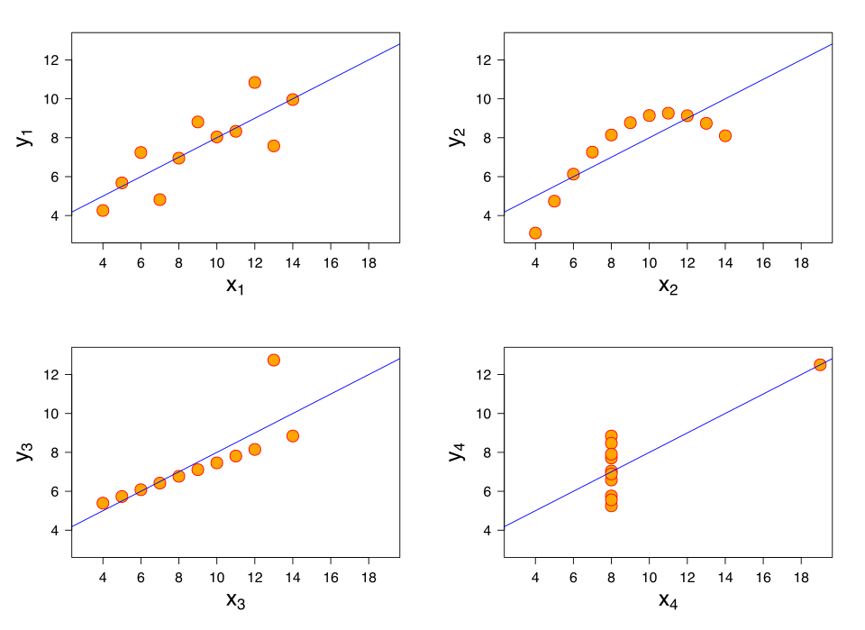

## What We Did

We used data visualization to reveal patterns that summary statistics can hide. The class introduced Anscombe's quartet, the Grammar of Graphics, the structure of a ggplot2 plot, common geoms, and ways to represent uncertainty in American Community Survey (ACS) estimates.

We also connected visualization to data quality by calculating coefficients of variation, propagating margins of error for derived estimates, and testing whether change over time is statistically distinguishable from sampling error.

## Key Concepts

- A graph is a mapping from variables in a dataset to visual properties such as position, color, size, shape, and transparency.
- Anscombe's quartet shows why summary statistics alone are not enough: very different datasets can share nearly identical means, variances, correlations, and regression lines.
- In ggplot2, data and aesthetic mappings are combined with one or more geom layers.
- Put a variable inside aes() when it should control a visual property; put a constant outside aes() when it is only decoration.
- Choose a geom based on the analytical question and the types of variables involved.
- ACS margins of error describe sampling uncertainty and should be shown or evaluated alongside estimates.
- For ACS data published after 2005, a 90% margin of error equals 1.645 standard errors.

## 1. Why Visualization Matters: Anscombe's Quartet



Anscombe's quartet contains four datasets with nearly identical numerical summaries, including the mean of x, mean of y, variance of x, variance of y, correlation, and fitted linear regression equation. However, the scatterplots reveal four very different structures: an approximately linear relationship, a curved relationship, an influential outlier, and a vertical cluster with one high-leverage point.

The lesson is not that statistics are unhelpful. The lesson is that numerical summaries and visualizations should be used together. A model can appear reasonable in a table while being misleading when the underlying pattern is plotted.

## 2. The Grammar of Graphics

The Grammar of Graphics treats a plot as a combination of components:

- **Data:** the table being visualized.
- **Aesthetic mappings:** how variables map to x-position, y-position, color, fill, size, shape, or alpha.
- **Geoms:** the marks drawn on the page, such as points, lines, bars, boxes, or intervals.
- **Scales:** how data values are translated into positions, colors, sizes, and labels.
- **Facets:** small multiples that divide the data into panels.
- **Coordinates:** the coordinate system and axis orientation.
- **Theme:** non-data styling such as fonts, grid lines, and background.

A minimal plot follows this pattern:

```r
library(ggplot2)

ggplot(data = tract_data, aes(x = population, y = moe_pct)) +
  geom_point()
```

- ggplot() initializes the plot and supplies the default data.
- aes() defines the default mappings from data columns to visual properties.
- geom_point() adds a layer that draws one point for each observation.
- The + operator adds layers and other components to the plot.

R is case-sensitive, so the correct function is geom_point(), not geom_Point().

## 3. Mapping Variables vs. Setting Constants

A variable placed inside aes() is **mapped** to a visual property:

```r
ggplot(tract_data, aes(x = population, y = moe_pct)) +
  geom_point(aes(color = reliability))
```

Here, each value of reliability receives a color, and ggplot2 creates a legend.

A value placed outside aes() is **set** as a constant:

```r
ggplot(tract_data, aes(x = population, y = moe_pct)) +
  geom_point(color = "steelblue", size = 2, alpha = 0.7)
```

Here, every point is steel blue, size 2, and slightly transparent. These choices decorate the layer and do not represent additional variables.

A common mistake is aes(color = "blue"). Because "blue" is inside aes(), ggplot2 treats it as a category label rather than as a literal color. Use color = "blue" outside aes() to make all points blue.

## 4. Choosing a Geom from the Question

| Analytical question | Typical geom | Notes |
| --- | --- | --- |
| How is one continuous variable distributed? | geom_histogram() or geom_density() | A histogram groups values into bins; bin width changes the visual story. |
| How do two continuous variables relate? | geom_point() | Add geom_smooth() only when a fitted trend is useful and appropriate. |
| How does a continuous variable differ across groups? | geom_boxplot() or geom_violin() | A boxplot summarizes the distribution; raw points can reveal sample size and outliers. |
| How many observations fall in each category? | geom_bar() | geom_bar() counts rows automatically. |
| What value has already been calculated for each category? | geom_col() | The bar height comes from a y variable in the data. |
| How does a value change over ordered time? | geom_line() plus geom_point() | Set the group aesthetic when multiple series are present. |
| How uncertain is an estimate? | geom_errorbar(), geom_linerange(), geom_pointrange(), or geom_ribbon() | Map lower and upper bounds explicitly. |

The misspelling geom_poxplot() in the original notes should be geom_boxplot().

## 5. Showing ACS Estimates with Margins of Error

ACS tables usually provide an estimate and a margin of error at the 90% confidence level. A simple interval plot makes both visible:

```r
library(dplyr)
library(ggplot2)

tract_data |>
  mutate(
    lower = estimate - moe,
    upper = estimate + moe
  ) |>
  ggplot(aes(x = reorder(NAME, estimate), y = estimate)) +
  geom_point() +
  geom_errorbar(aes(ymin = lower, ymax = upper), width = 0.2) +
  coord_flip() +
  labs(x = NULL, y = "Estimate with 90% MOE")
```

A large interval is not automatically a reason to discard an observation. It means the estimate is less precise and should be interpreted, compared, or mapped cautiously.

## 6. Coefficient of Variation and Reliability

The coefficient of variation (CV) expresses sampling error relative to the size of the estimate. Because the published ACS MOE is based on a 90% confidence level:

```text
SE = MOE / 1.645
CV = (SE / estimate) × 100
   = (MOE / (1.645 × estimate)) × 100
```

In R:

```r
tract_data <- tract_data |>
  mutate(
    se = moe / 1.645,
    cv = abs(se / estimate) * 100,
    reliability = case_when(
      cv <= 15 ~ "high",
      cv <= 30 ~ "medium",
      TRUE ~ "low"
    )
  )
```

A common classroom interpretation is:

- **CV at or below 15%:** high reliability.
- **CV above 15% and at or below 30%:** medium reliability.
- **CV above 30%:** low reliability and high relative sampling error.

These cutoffs are practical categories, not universal laws. CV is also unstable or undefined when an estimate is zero or very close to zero, and it can be hard to interpret for estimates that may be negative. In those cases, inspect the estimate and MOE directly.

## 7. Margins of Error for Derived Estimates

When estimates are combined, their margins of error cannot usually be added or divided directly. Uncertainty must be propagated with an appropriate formula.

The tidycensus package provides helper functions:

- moe_sum(): the MOE for a sum of several estimates.
- moe_prop(): the MOE for a proportion when the numerator is a subset of the denominator, such as people below poverty divided by the population for whom poverty status is determined.
- moe_ratio(): the MOE for a ratio when the numerator is not a subset of the denominator.
- moe_product(): the MOE for a product of two estimates.

The estimate itself and its derived MOE are separate outputs. Check the documentation and supply both estimate and MOE inputs in the order required by the selected function.

## 8. Comparing Change over Time

ACS 5-year estimates describe a five-year period, not a single point in time. Avoid comparing overlapping periods such as 2018–2022 and 2019–2023 because four years of underlying data are shared. For a cleaner comparison, use non-overlapping periods such as 2014–2018 and 2019–2023.

Suppose the estimates and published 90% MOEs are:

- 2014–2018: $45,000 ± $8,000
- 2019–2023: $62,000 ± $11,000

First convert each MOE to a standard error:

```text
SE1 = 8,000 / 1.645 = 4,863
SE2 = 11,000 / 1.645 = 6,687
```

For two non-overlapping estimates, the approximate standard error of the difference is:

```text
Difference = 62,000 - 45,000 = 17,000
SEdiff = sqrt(SE1² + SE2²)
       = sqrt(4,863² + 6,687²)
       ≈ 8,269
```

The z statistic is:

```text
z = Difference / SEdiff
  = 17,000 / 8,269
  ≈ 2.06
```

At the ACS standard 90% confidence level, compare the absolute z value with 1.645. Because 2.06 > 1.645, the estimated increase is statistically significant at the 90% level.

The 90% MOE and confidence interval for the change are:

```text
MOE of difference = 1.645 × 8,269 ≈ 13,600
90% interval       = 17,000 ± 13,600
                   ≈ [$3,400, $30,600]
```

The original calculation ended with $1,369; the correct value is approximately $13,600. Statistical significance does not automatically imply that the change is large enough to matter for policy, and the calculation addresses sampling error rather than every possible source of bias.

## Reflection

This week showed me why data visualization is part of analysis rather than a final decoration step. Anscombe's quartet demonstrates that identical summary statistics can hide very different data structures. The Grammar of Graphics gives me a systematic way to build a plot by connecting variables, aesthetics, and geoms. For ACS data, I also need to visualize and calculate uncertainty so that a precise-looking estimate is not mistaken for a certain one.

## Questions I Still Have

- When should I use color, size, shape, or facets to encode an additional variable without making a plot difficult to read?
- How should I choose bin width for a histogram and explain that choice?
- When are error bars, ribbons, or reliability categories most appropriate for communicating ACS uncertainty?
- How should I compare estimates when ACS periods overlap or when the variable definition changes between releases?
