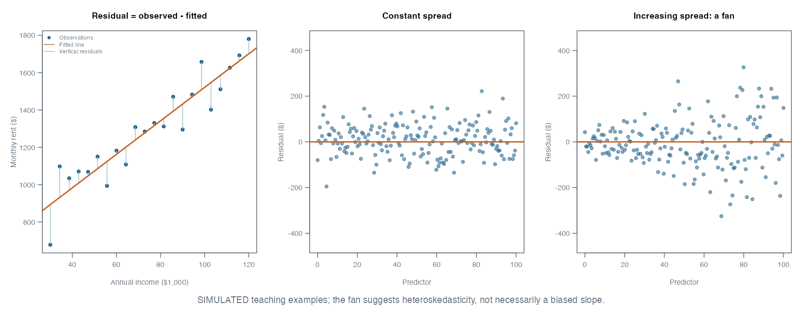
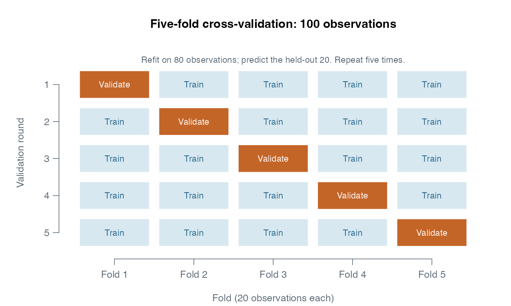

## What We Did

We used Philadelphia Census tracts to ask where monthly rents are higher than a
model would predict from neighborhood characteristics. The lesson connected
linear regression, least squares, coefficient interpretation, survey uncertainty,
train/test evaluation, cross-validation, and residual maps.

These notes combine my original class notes and board photographs with the
Week 5 lab and a peer's topic checklist. Numerical examples explicitly marked
"board example" are teaching values, not newly estimated Philadelphia results.

## Key Concepts

- Prediction asks for an accurate $\hat y$; coefficient inference asks what we can
  learn about $\beta$. Neither automatically establishes causation.
- A residual is observed minus fitted: $e_i=y_i-\hat y_i$. Positive means rent is
  higher than predicted; negative means lower.
- Ordinary least squares minimizes squared **vertical** residuals.
- A good training fit does not guarantee accurate predictions on new tracts.
- Evaluate candidate models using the same rows, folds, outcome units, and metric.
- Survey coefficient of variation and model cross-validation both abbreviate to
  **CV**, but answer different questions.

## Notes

### 1. The modeling table and the question

Each row represents a tract, not a household. The target is a tract-level median
monthly gross rent. Income is a tract-level median annual household income.

| Variable | Role and meaning | Unit or check |
|---|---|---|
| `GEOID` | Tract identifier | Character text; preserve leading zeros |
| `med_rentE` | Outcome: estimated median gross rent | Dollars per month |
| `med_incE` | Predictor: estimated median household income | Dollars per year |
| `pct_renter` | Renter-occupied / all occupied housing units | Lab uses 0–100, not 0–1 |
| `pct_ba` | BA or higher / population age 25+ | Lab uses 0–100 |
| `n_stations` | Number of nearby Indego bike-share stations | Count, not a causal treatment |
| `rent_cv` | Relative sampling uncertainty of the rent estimate | Percent |
| `geometry` | Tract polygon | Keep for spatial calculations and mapping |

The handwritten `0.71` corresponds to a proportion of 71%; the lab's percentage
variable would be `71`. With a 0–100 predictor, increasing it by 1 means **one
percentage point**. With a 0–1 proportion, one percentage point is `0.01`.
The renter denominator is occupied housing units, not all residents.

The lab counts stations within half a mile of the **tract polygon**. A station
inside a tract has distance zero; one near any part of its boundary may count.
This does not establish that every resident is within a half-mile walk.

```r
tracts <- philly_tracts |>
  mutate(
    pct_renter = 100 * renter_occE / occ_unitsE,
    pct_ba = 100 * (baE + maE + profE + phdE) / edu_totalE,
    rent_se = med_rentM / 1.645,
    rent_cv = 100 * rent_se / med_rentE
  )
```

Before fitting, check positive denominators and finite values. Build a common
analysis sample for all candidate models, report which rows were lost, and keep
GEOIDs in the same order. Otherwise `lm()` may omit rows and residuals may no
longer line up with the map.

### 2. The unknown relationship, fitted values, and errors

The conceptual data-generating relationship is

$$
Y=f(X)+\epsilon.
$$

Here $f$ is an unknown relationship, $X$ is the available information, and
$\epsilon$ is remaining variation. A simple linear model approximates it by

$$
Y_i=\beta_0+\beta_1X_i+\epsilon_i,
\qquad \hat Y_i=\hat\beta_0+\hat\beta_1X_i.
$$

The prediction formula has no added unknown $\epsilon_i$: we cannot know that
individual error in advance. The theoretical error $\epsilon_i$ and fitted
residual $e_i$ are related but distinct; residuals become observable after fitting.

| Objective | Example question | Evidence to examine |
|---|---|---|
| Prediction, $\hat y$ | What monthly rent should we expect for a tract? | Held-out errors and stability |
| Inference, $\hat\beta$ | How much does predicted rent differ with income, conditional on included predictors? | Coefficients, uncertainty, assumptions |
| Causal inference | Would installing a station change rent? | A credible causal design, beyond an observational coefficient |

An Indego-station count can help prediction by representing centrality or
amenities. That predictive usefulness does not prove that stations cause rents
to increase. Tract relationships also do not establish individual household
relationships: that would risk an ecological inference error.

### 3. Flexibility and model families

The board placed linear models at the simpler end and trees, forests, boosting,
and neural networks toward the more flexible end. Treat this as an intuition,
not a universal ranking. Flexibility depends on features and tuning: a shallow
tree may be simple, while a linear regression with many basis functions may be
flexible.

- Linear regression specifies a form and estimates its coefficients.
- Ridge and lasso regularize coefficients; with the same features, their penalties
  generally constrain flexibility rather than automatically increasing it.
- Logistic regression models probabilities for a categorical outcome. It is not
  simply the next more flexible model for predicting a continuous rent amount.
- Nonparametric methods allow the fitted relationship's complexity to adapt more
  to the data. "Nonparametric" does not mean that there are no parameters or
  assumptions.

Greater flexibility can reduce underfitting but may fit accidental patterns in
the training sample. Validation tells us whether the extra complexity helps.

### 4. How least squares chooses the line

For every observation, compute a residual and square it:

$$
e_i=y_i-\hat y_i,
\qquad RSS=\sum_i e_i^2.
$$

OLS chooses coefficients that minimize $RSS$. Squaring stops positive and
negative residuals from canceling and gives larger misses greater weight.
The distances are vertical, in the outcome direction; OLS does not minimize
the shortest perpendicular distance to the line.



### 5. Reading `lm()` output in meaningful units

```r
m1 <- lm(med_rentE ~ med_incE, data = tracts)
summary(m1)
coef(m1)["med_incE"] * 10000
```

The rounded board example gives this fitted equation:

$$
\widehat{\text{monthly rent}}=690+0.0081\times\text{annual income}.
$$

An income difference of $10,000 corresponds to an $81 difference in predicted
monthly rent. At income $82,000, predicted rent is $1,354.20. If observed rent
is $1,650, the residual is $295.80: observed rent exceeds the prediction.

The intercept is the prediction at income zero. This can be outside the data's
useful range, so it is not necessarily a meaningful description of actual tracts.

| Output | Interpretation |
|---|---|
| Estimate | Fitted coefficient, with units determined by $Y$ and $X$ |
| Standard error | Estimated uncertainty of the coefficient, not a tract's prediction error |
| t statistic | `(estimate - null value) / SE`; the usual null value is zero |
| p-value | Under the null and assumptions, probability of a statistic at least this extreme |

For the board slope and rounded SE, $0.0081/0.0005=16.2$. A two-sided 5% test
uses a t critical value based on residual degrees of freedom; 1.96 is a large-
sample approximation. A small p-value does not measure predictive accuracy,
practical importance, or the probability that the null hypothesis is true.

In multiple regression, a slope describes an association **holding the other
included predictors constant**. Changing the model can change that slope.

### 6. Noise in the outcome and in predictors

Random outcome measurement error that is mean-zero conditional on the predictors
adds uncertainty and tends to enlarge residuals; it does not by itself create a
systematic slope bias. Outcome errors related to predictors can bias results.
Residuals may also contain omitted systematic patterns, model misspecification,
and spatial dependence, not just random noise.

Classical independent measurement error in the single predictor of a simple
regression tends to shrink its slope toward zero: **attenuation bias**. In
multiple regression or with nonclassical measurement error, the direction is
not guaranteed. The board's "noise in X flattens the slope" needs these conditions.

ACS median rent is itself an estimate. Its 90% margin of error can be converted
approximately to a standard error by dividing by 1.645. For a positive estimate,

$$
CV_{\text{estimate}}=100\times\frac{SE}{\text{estimate}}.
$$

A 35% CV means the SE is 35% of the estimate; the 90% MOE is approximately
57.6% of it. It does **not** tell us exactly what fraction of a model residual is
sampling noise. Large residuals should be considered alongside estimate
uncertainty before being treated as policy flags.

### 7. Training fit versus prediction performance

For an ordinary unweighted model with an intercept, training

$$
R^2=1-\frac{\sum_i(y_i-\hat y_i)^2}{\sum_i(y_i-\bar y)^2}.
$$

Adding predictors on the same training rows cannot decrease ordinary training
$R^2$, even if the additions do not generalize. Adjusted $R^2$ penalizes complexity
but still does not replace held-out evaluation. $R^2$ can also be calculated out
of sample, where it can be negative; always state which data produced a metric.

RMSE takes the root of the average squared prediction error:

$$
RMSE=\sqrt{\frac{1}{n}\sum_i(y_i-\hat y_i)^2}.
$$

For observed rents `(500, 900)` and predictions `(400, 1200)`, the errors are
`(100, -300)`, squared errors are `(10000, 90000)`, and RMSE is about $223.61.
RMSE has the same units as rent and emphasizes large errors. It is not the mean
absolute error (which is $200 in this example).

`summary(lm)$sigma` uses residual degrees of freedom in its denominator, whereas
training RMSE uses $n$. They need not match.

### 8. Train/test splits and K-fold cross-validation

An 80/20 split fits a model on 80% of observations and evaluates predictions on
the unused 20%. Training error is usually smaller, though an individual random
split can be an exception. A single split can give a lucky or unlucky result.

Five-fold CV partitions 100 records into five groups of 20. Fit five separate
models, each on 80 records, and predict the remaining 20. Every observation gets
one out-of-fold prediction from a model that did not train on that observation.



Two legitimate summaries are often both called "CV RMSE":

$$
\text{mean fold RMSE}=\frac{1}{K}\sum_k RMSE_k,
$$

$$
\text{pooled OOF RMSE}=\sqrt{\frac{\sum_k n_k RMSE_k^2}{\sum_k n_k}}.
$$

They generally differ because taking a square root and taking an average do not
commute. The Week 6 helper uses pooled out-of-fold RMSE; the lab's `caret` output
typically reports the mean resampled RMSE. Use one definition consistently.

The following base-R pattern makes the common folds explicit. It assumes a
previously prepared complete `model_df`, with one row per tract.

```r
model_df <- sf::st_drop_geometry(tracts)
set.seed(5080)
fold_id <- sample(rep(1:5, length.out = nrow(model_df)))
oof <- rep(NA_real_, nrow(model_df))

for (k in sort(unique(fold_id))) {
  holdout <- fold_id == k
  fit <- lm(med_rentE ~ med_incE + pct_renter + pct_ba + n_stations,
            data = model_df[!holdout, ], na.action = na.fail)
  oof[holdout] <- predict(fit, newdata = model_df[holdout, ])
}
stopifnot(all(is.finite(oof)))
sqrt(mean((model_df$med_rentE - oof)^2))
```

### 9. Choosing features without leaking information

Compare candidate feature sets on identical rows and folds. A variable with a
small p-value need not improve prediction, and a useful predictor need not have
a stable causal interpretation. Prefer an improvement that is repeatable and
large enough to matter, rather than overinterpreting a tiny RMSE difference.

Imputation medians, scaling parameters, data-driven cutoffs, and feature selection
must be learned from the training portion of each split. Otherwise information
from validation observations leaks into model construction. Reusing CV scores
to choose among many models also makes the winner's reported score optimistic;
an untouched final test set or nested CV provides a more independent assessment.

Randomly split neighboring tracts may be very similar. If deployment means
predicting new neighborhoods or another city, geographically blocked validation
can be more informative than random folds. Choose the split to match the intended
prediction task.

### 10. Multicollinearity and heteroskedasticity

**Multicollinearity** means that predictors carry overlapping information. It
can inflate coefficient standard errors, make coefficients unstable, and make
individual effects hard to separate. Predictions within a similar predictor
distribution may still be accurate. Perfect collinearity makes some coefficients
unidentifiable; distribution changes and extrapolation can expose instability.
Therefore "mostly harmless for prediction" is a qualified observation, not a rule.

**Homoskedasticity** is constant conditional error variance. A fan-shaped residual
plot suggests **heteroskedasticity**: the uncertainty differs across observations.
OLS slopes can remain unbiased under the zero-conditional-mean assumption, but
conventional standard errors and prediction intervals can be wrong. Robust SEs
address coefficient uncertainty under appropriate conditions; they do not repair
a missing nonlinear relationship or automatically improve point predictions.

```r
plot(fitted(m1), residuals(m1),
     xlab = "Fitted rent", ylab = "Residual")
abline(h = 0, lty = 2)
# If installed: lmtest::bptest(m1)
```

### 11. Reading a residual map

Attach predictions and errors to the same tract rows, then use a diverging color
scale centered on zero. A cluster of positive errors can suggest an omitted
location-related feature, a nonlinear pattern, or correlated data problems.
It does not identify a causal explanation by itself.

```r
tracts$residual <- residuals(m1)  # only if no rows were silently omitted
ggplot(tracts) +
  geom_sf(aes(fill = residual), color = NA) +
  scale_fill_gradient2(low = "#2166ac", mid = "white", high = "#b2182b",
                       midpoint = 0) +
  labs(fill = "Observed - fitted rent ($)") +
  theme_void()
```

Distinguish in-sample residual maps used for diagnosis from out-of-fold error
maps used to inspect predictive performance. For policy triage, consider error
size, survey MOE/CV, and whether the model was evaluated honestly.

## Proving R Works

This reproducible numerical check uses the board's teaching values and requires
no API key. The expected RMSE is 223.61 and the predicted rent is 1,354.20.

```{r}
#| label: week5-numerical-check
observed <- c(500, 900)
predicted <- c(400, 1200)
round(c(
  RMSE = sqrt(mean((observed - predicted)^2)),
  predicted_rent = 690 + 0.0081 * 82000,
  residual = 1650 - (690 + 0.0081 * 82000)
), 2)
```

## Check Your Understanding

1. Actual rent is $1,800 and predicted rent is $1,500. What is the residual?
2. A slope is `0.0081`. What does $10,000 more annual income imply for predicted
   monthly rent?
3. Model A has higher training $R^2$ but higher held-out RMSE than B. Which is
   better supported for prediction under that evaluation?
4. Does a tiny station-count p-value prove that adding a station raises rent?
5. In five-fold CV with 100 records, how many observations train each model and
   how many are held out?
6. Are `rent_cv` and cross-validation the same thing?

**Answers:** 1. +$300, above prediction. 2. +$81, as an association. 3. B,
assuming comparable data and a meaningful difference. 4. No. 5. 80 and 20, repeated
five times. 6. No: estimate uncertainty versus held-out model evaluation.

## Reflection

The central habit is to specify the question before interpreting a regression.
The same coefficient can help prediction while being inadequate for a causal
claim. A residual is useful evidence about where a model misses, but ACS
uncertainty and spatial structure also matter when interpreting that miss.

## Questions I Still Have

- How much of the apparent predictive advantage survives geographically blocked
  validation?
- How should a housing agency combine model error and ACS uncertainty when
  deciding which tracts need further investigation?

## Sources and Scope

- My Week 5 Joplin notes, board photographs, and [completed class lab](../practice/week5_lab_challenge.qmd).
- [Peer Week 5 notes](https://github.com/CyannnZ/MUSA-5080-portfolio/blob/main/weekly-notes/week-05.qmd), used to check topic coverage.
- [R documentation: `lm()`](https://stat.ethz.ch/R-manual/R-devel/library/stats/html/lm.html) and [prediction from linear models](https://stat.ethz.ch/R-manual/R-devel/library/stats/html/predict.lm.html).
- Figures are newly drawn teaching illustrations. They do not reproduce an
  empirical Philadelphia scatterplot. Code blocks outside “Proving R Works” are
  study examples and require the named class objects.
