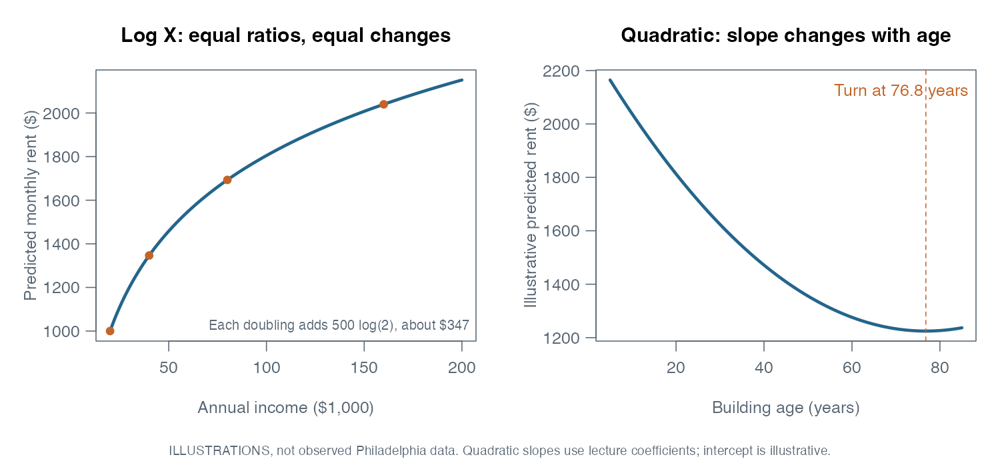
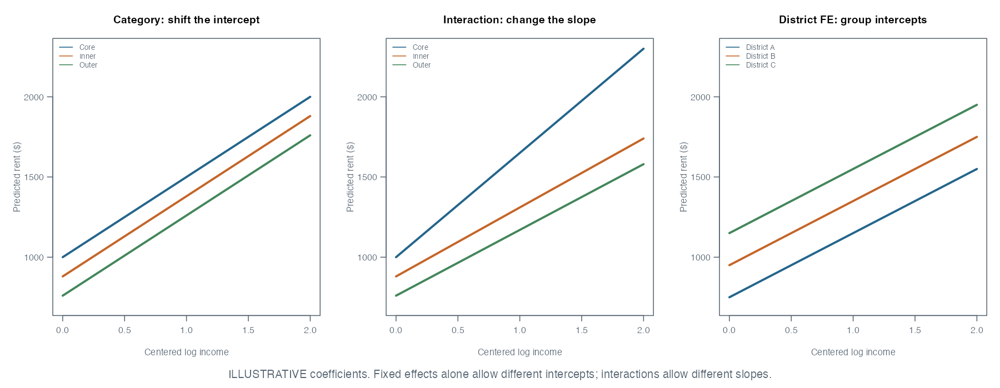
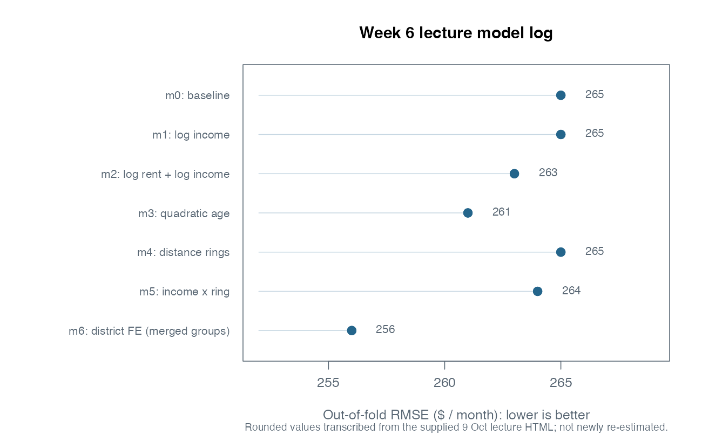

## What We Did

The recorded lecture used Philadelphia tract-level rents to ask how much better
a model can become when we change the way its predictors represent the world.
We worked through logs, a quadratic age term, distance categories, interactions,
and planning-district fixed effects.

The source is Dr. Elizabeth Delmelle's recorded lecture HTML dated October 9,
2026. Its linked image folder was not included in my copy. The figures below
are therefore newly drawn **teaching illustrations**, not recovered empirical
plots. Coefficients and model scores identified as lecture results are
transcribed from that HTML, not newly estimated here.

## Key Concepts

- Feature engineering changes the information or functional form presented to a
  model. It should follow the question and be checked on held-out observations.
- Logs express multiplicative changes; quadratic terms let a slope vary with a
  predictor; categories represent distinct groups.
- Without interactions, category indicators shift intercepts. Interactions can
  make slopes differ across groups.
- District fixed effects add district-specific intercepts. They do not explain
  which neighborhood mechanism causes a rent difference.
- Compare models on the same rows, folds, and outcome scale. A log-scale RMSE
  and a dollar-scale RMSE cannot be ranked against each other.

## Notes

### 1. Construct the analysis table carefully

The lecture uses 2023 ACS five-year estimates and reports 377 eligible tracts.
That row count is a lecture result, not a promise about a fresh API download.

| Feature | Construction | Meaning / caution |
|---|---|---|
| `rent` | `rentE`, ACS `B25064_001` | Median gross monthly rent; outcome in dollars |
| `income` | `incomeE`, `B19013_001` | Median annual household income in dollars |
| `bldg_age` | `2023 - yr_builtE`, `B25035_001` | Approximate age from median year built, not each building's age |
| `pct_renter` | `100 * hh_renterE / hh_totalE` | Percentage of occupied units that are renter occupied |
| `dist_ch_mi` | Shortest tract-polygon distance to City Hall / 5280 | Miles after projection to EPSG:2272 |
| `geometry` | Tract polygon | Needed for distances, joins, and maps |

```r
library(tidycensus)
library(sf)
library(dplyr)
library(ggplot2)

tracts <- get_acs(
  geography = "tract", state = "PA", county = "Philadelphia",
  variables = c(rent = "B25064_001", income = "B19013_001",
                yr_built = "B25035_001", hh_total = "B25003_001",
                hh_renter = "B25003_003"),
  year = 2023, survey = "acs5", output = "wide", geometry = TRUE
) |> st_transform(2272)

city_hall <- st_sfc(st_point(c(-75.1636, 39.9526)), crs = 4326) |>
  st_transform(st_crs(tracts))

tracts <- tracts |>
  mutate(
    rent = rentE,
    income = incomeE,
    bldg_age = 2023 - yr_builtE,
    pct_renter = 100 * hh_renterE / hh_totalE,
    dist_ch_mi = as.numeric(st_distance(geometry, city_hall)) / 5280
  )

# Define eligibility once, before comparing models that need positive logs.
tracts <- tracts |>
  filter(is.finite(rent), rent > 0,
         is.finite(income), income > 0,
         is.finite(bldg_age), bldg_age >= 0,
         hh_totalE > 0, is.finite(pct_renter),
         between(pct_renter, 0, 100), is.finite(dist_ch_mi))
d <- st_drop_geometry(tracts)
```

EPSG:2272 uses US survey feet; it is not a meter CRS. The lecture's division by
5280 follows its feet-to-miles convention. A tract containing City Hall has
polygon-to-point distance zero. This feature is **not centroid distance**, walking
distance, or the distance of every resident. Changing the distance definition
changes the feature and potentially the answer.

Keep a record of excluded rows. ACS sampling uncertainty still exists after
feature engineering; a transformed variable is not a more precise survey estimate.

### 2. Start with a baseline and a fixed evaluation design

The baseline is

```r
f0 <- rent ~ income + pct_renter + bldg_age + dist_ch_mi
m0 <- lm(f0, data = d, na.action = na.fail)
```

The lecture assigns ten folds once. Every model must use that same assignment,
not a freshly randomized split that may make a model look better by chance.
This helper makes the fold assignment explicit instead of depending on a global
variable. It computes **pooled out-of-fold RMSE**, not an unweighted average of
ten separate RMSEs.

```r
set.seed(5080)
fold_id <- sample(rep(1:10, length.out = nrow(d)))

cv_rmse <- function(formula, data, fold_id, log_outcome = FALSE) {
  stopifnot(length(fold_id) == nrow(data), !anyNA(fold_id))
  pred <- rep(NA_real_, nrow(data))
  for (k in sort(unique(fold_id))) {
    train <- fold_id != k
    fit <- lm(formula, data = data[train, , drop = FALSE],
              na.action = na.fail)
    p <- predict(fit, newdata = data[!train, , drop = FALSE])
    if (log_outcome) p <- exp(p)  # the lecture's back-transformation rule
    pred[!train] <- p
  }
  stopifnot(all(is.finite(pred)), all(is.finite(data$rent)))
  sqrt(mean((data$rent - pred)^2))
}

cv_rmse(f0, d, fold_id)
```

All imputation, learned scaling, data-driven cutoffs, feature selection, and
optional log-bias correction must be fitted using each training fold only.
Fixed, pre-specified rules such as `log(income)` and a two-mile boundary do not
estimate parameters from the held-out outcomes. The final test set remains
untouched during model selection.

### 3. Log-transform a predictor: diminishing marginal dollar changes

```r
f1 <- rent ~ log(income) + pct_renter + bldg_age + dist_ch_mi
```

R's `log()` is the natural logarithm. Equal ratios have equal log differences:
doubling 20,000 to 40,000 and doubling 40,000 to 80,000 both change log income by
$\log(2)$. This lets a model represent a relationship where another dollar of
income matters less at higher income levels.

For $Y=\beta_0+\beta_1\log(X)+\cdots$, multiplying $X$ by $r$ changes the fitted
level of $Y$ by $\beta_1\log(r)$, holding the other predictors fixed.
The lecture coefficient is about **502.1787**: a 1% income increase corresponds
to approximately 5.02 dollars more monthly rent, or exactly
$502.1787\log(1.01)\approx5.00$ dollars. It does **not** mean 502 dollars per
additional dollar of income.



A skewed predictor does not itself violate an OLS requirement: OLS does not
require the predictors to be normally distributed. Use logs because the
relationship or variance structure suggests them, then examine fit and validation.

**Zeros and missing values:** `log(0)` is `-Inf`; negative values do not have a
real natural log. `log1p(x)` computes `log(1 + x)` and can be useful for nonnegative
counts containing zero. It is not a universally interchangeable substitute for
`log(x)`: its percentage interpretation differs near zero and depends on the
measurement units. Investigate negative sentinel values rather than adding an
arbitrary constant to everything.

### 4. Log-transform the outcome: interpret changes in percentages

```r
f2 <- log(rent) ~ log(income) + pct_renter + bldg_age + dist_ch_mi
```

The four common forms have different interpretations. These describe the
fitted relationship with all other included variables held fixed.

| Model component | Interpretation of coefficient $\beta$ |
|---|---|
| $Y\sim X$ | One extra X unit corresponds to $\beta$ Y units |
| $Y\sim\log(X)$ | 1% more X corresponds to approximately $\beta/100$ Y units; exact $\beta\log(1.01)$ |
| $\log(Y)\sim X$ | One extra X unit changes the back-transformed fitted value by approximately $100\beta$%; exact $100(e^\beta-1)$% |
| $\log(Y)\sim\log(X)$ | 1% more X changes the back-transformed fitted value by approximately $\beta$%; exact $100(1.01^\beta-1)$% |

The lecture's log-income coefficient is **0.3633423**. It is an elasticity:
a 1% income increase is associated with roughly a 0.363% increase in the
back-transformed fitted rent. A 10% increase is about
$100(1.10^{0.3633423}-1)\approx3.52$%, not 36.3%.

For `pct_renter`, a one-unit increase means **one percentage point** because the
feature is coded 0–100. Do not confuse a percentage point in X with a percentage
change in Y.

#### Compare predictions in dollars

```r
log_fit <- lm(f2, data = d, na.action = na.fail)
rent_pred <- exp(predict(log_fit, newdata = d))
cv_rmse(f2, d, fold_id, log_outcome = TRUE)
```

The HTML reports an in-sample log RMSE of about 0.1885 and a back-transformed
dollar RMSE of about 259.55. They use different units; 0.1885 is not evidence
that the model beats a 265-dollar held-out RMSE. Both the scale and the evaluation
sample have changed in that comparison.

There is a further subtlety: `exp(predicted_log_rent)` estimates the exponential
of the conditional mean of log rent, not generally the arithmetic conditional
mean of rent. It corresponds to a conditional median under a symmetric log-error
distribution. Because exponentiation is nonlinear, simple exponentiation can
underpredict the mean. A smearing correction can multiply by the mean of
`exp(residuals(fit))`, under suitable error-distribution assumptions. If used in
CV, estimate that correction from **training residuals only**. The reported
lecture comparison uses simple exponentiation; do not silently change that rule
and label the resulting score as the same experiment.

### 5. Add a squared term: curvature without changing model family

The next lecture model returns to **rent in dollars**; the models are not all
cumulative additions to the log-outcome model.

```r
f3 <- rent ~ log(income) + pct_renter + bldg_age +
  I(bldg_age^2) + dist_ch_mi
```

`I()` means “interpret this arithmetic as written.” In an R formula, `^` otherwise
has a special formula meaning. Include the linear age term as well as its square.
The model is curved in age but still linear in its coefficients, so it is still
a linear regression.

The lecture age coefficients are approximately $\beta_1=-28.00445$ and
$\beta_2=0.1823244$:

$$
\frac{\partial\widehat{rent}}{\partial age}
=\beta_1+2\beta_2 age,
\qquad age^*=-\frac{\beta_1}{2\beta_2}\approx76.8.
$$

The marginal slope is therefore not a constant −28 dollars per year. It becomes
less negative as age increases and is positive beyond the fitted turning point.
The source reports ages roughly 5–85, so little data lie beyond that turn.
Check the original ACS coding and oldest-year category before interpreting a
pile-up of very old housing. A curve near the edge of the data is not proof that
aging a particular building raises its rent. Extrapolating a quadratic far
outside the observed ages is especially risky.

### 6. Categories and reference groups

The lecture replaces continuous City Hall distance with three rings:

```r
d <- d |>
  mutate(
    ring = case_when(
      is.na(dist_ch_mi) ~ NA_character_,
      dist_ch_mi < 2 ~ "Core",
      dist_ch_mi < 5 ~ "Inner",
      TRUE ~ "Outer"
    ),
    ring = factor(ring, levels = c("Core", "Inner", "Outer")),
    renter_band = cut(pct_renter, breaks = c(0, 33, 66, 100),
                      labels = c("Low", "Medium", "High"),
                      include.lowest = TRUE)
  )
f4 <- rent ~ log(income) + pct_renter + bldg_age + I(bldg_age^2) + ring
```

The ring boundaries are `[0, 2)`, `[2, 5)`, and `[5, infinity)`: exactly two miles
is Inner and exactly five is Outer. For the `cut()` example, the default is
right-closed, so the intervals are `[0,33]`, `(33,66]`, and `(66,100]`.
Writing an explicit missing-value branch prevents unknown distance from being
silently classified as Outer.

With an intercept and the usual treatment contrasts, a factor with $k$ levels
has $k-1$ indicator coefficients. Core is the reference here. The lecture's
Inner coefficient of −122.28 and Outer coefficient of −164.19 represent dollar
differences from Core at the same values of the other predictors.

```r
d$ring <- relevel(d$ring, ref = "Outer")
# Refit the same formula on the same rows to change the comparison group.
# Restore Core before interpreting the lecture interaction coefficients below.
d$ring <- relevel(d$ring, ref = "Core")
```

Changing only the reference group changes coefficient labels and the intercept,
not fitted predictions or RMSE. With Outer as reference, the same example gives
Core +164.19 and Inner about +41.92. A no-intercept specification can instead
use one indicator for every category.

Categories simplify interpretation but discard within-bin differences: 2.1 and
4.9 miles now receive the same ring contribution. Choose meaningful boundaries;
do not expect binning automatically to improve prediction.

### 7. Interactions: an effect can depend on another variable

```r
f5 <- rent ~ log(income) * ring + pct_renter + bldg_age + I(bldg_age^2)
# log(income) * ring expands to:
# log(income) + ring + log(income):ring
```

With Core as reference, the income slope in Inner is the main log-income
coefficient **plus** the Inner interaction coefficient. The interaction
coefficient alone is the difference in slopes, not the full Inner slope.

| Ring | Lecture log-income slope | Approximate dollars for 1% more income |
|---|---:|---:|
| Core | 653.6974 | 6.54 |
| Inner | 653.6974 − 219.1028 = 434.5946 | 4.35 |
| Outer | 653.6974 − 244.4214 = 409.2760 | 4.09 |

Once an interaction is present, a ring's main coefficient is its difference
from Core at `log(income) = 0`, meaning income equals one dollar—not the usual
tract. The group difference at a meaningful income also includes the interaction
term. Centering log income around a meaningful reference makes that intercept
comparison easier to understand; any sample-estimated centering constant belongs
inside the training-fold workflow.



### 8. Planning-district fixed effects

Fixed effects here mean one intercept adjustment per planning district, not a
new causal estimation technique by itself. A simplified model is

$$
rent_i=\alpha_{district(i)}+\beta\log(income_i)+\gamma'Z_i+\epsilon_i.
$$

There are 18 districts in the lecture. Under ordinary treatment coding with an
intercept, this yields 17 district indicators. Treat a district ID as a factor,
not a continuous number.

```r
# districts: planning-district polygons loaded from the city's spatial data
districts <- st_transform(districts, st_crs(tracts))
tracts_fe <- st_join(
  tracts,
  districts |> select(district = dist_name),
  largest = TRUE
) |>
  mutate(district = factor(district))

# Check validity, missing districts, one row per original GEOID, and counts.
stopifnot(nrow(tracts_fe) == nrow(tracts),
          !anyDuplicated(tracts_fe$GEOID))
d_fe <- st_drop_geometry(tracts_fe)
table(d_fe$district, useNA = "ifany")
f6 <- rent ~ log(income) + pct_renter + bldg_age + I(bldg_age^2) + district
```

`largest = TRUE` assigns the district with the largest overlap for each tract.
This is an area-overlap rule, not a centroid rule. Check invalid polygons,
unmatched tracts, and ambiguous ties. Tract boundaries can cross districts;
one district per tract is a modeling simplification.

The lecture's log-income coefficient drops from roughly 519.74 to 427.39 after
including district effects. The coefficient now reflects comparisons within
districts, conditional on the other predictors. District indicators absorb
additive differences common to each district. They do not eliminate confounding
that varies within districts, identify specific amenities, or prove causality.

An in-sample residual map can become less clustered because the model has more
location parameters. That is a useful diagnostic, not independent evidence of
better prediction. Use the same diverging color limits for before/after maps
and check held-out errors as well.

#### Rare districts and unseen factor levels

One source district has only one tract. If that tract is held out, there is no
training observation from which to estimate its district effect. `predict.lm()`
can fail on a new factor level; merely defining factor labels does not supply an
estimable coefficient.

The lecture's CV variant merges very small districts into a coarser grouping
called `district_cv`. Thus its reported CV score uses **merged groups**, whereas
some preceding coefficient and residual illustrations use the original districts.
Keep this distinction in the experiment log.

Before CV, inspect how many training examples of each category remain in every
fold. A group size threshold such as ten does not mathematically guarantee
coverage in every random split. Use a documented, geographically sensible
coarser geography and an explicit missing/unseen-category policy. Nearest-polygon
distance can tie at zero for neighbors, so an automatic nearest-feature merge
is not necessarily a meaningful district assignment.

District fixed effects can predict new tracts in represented districts. They do
not automatically predict a wholly unseen district. Grouped or spatially blocked
validation tests a harder deployment question than a random tract split.

### 9. Compare the experiments, not just the formulas

These are the **rounded ten-fold pooled RMSE values printed in the supplied
lecture**, in dollars per month. They have not been rerun against the live ACS.

| Model | Main specification change | Lecture CV RMSE |
|---|---|---:|
| m0 | Baseline: income + renter percentage + age + distance | 265 |
| m1 | Log income; rent stays in dollars | 265 |
| m2 | Log rent and log income; exponentiate predictions | 263 |
| m3 | Return to dollar rent; add quadratic age to m1 | 261 |
| m4 | Replace distance with rings in m3 | 265 |
| m5 | Add log-income × ring interactions to m4 | 264 |
| m6 | Use district fixed effects; merge sparse groups for CV | 256 |



The district model performs best in this particular log. Its improvement from
265 to 256 is about nine dollars, or 3.4%. Small differences should be checked
for stability across repeated splits and, after selection, an untouched test
sample. More complicated terms do not necessarily reduce held-out error.

A useful experiment log records the formula, outcome scale, eligible rows,
fold IDs, preprocessing, back-transformation rule, category handling, and metric.
Do not compare the Week 5 average-fold score directly with a Week 6 pooled score
and attribute every difference to feature engineering.

## Proving R Works

This executable check verifies coefficient arithmetic without requesting live
ACS data. It also confirms that changing a reference group preserves predictions.

```{r}
#| label: week6-numerical-check
round(c(
  log_X_exact_1pct_dollars = 502.1787 * log(1.01),
  log_log_exact_10pct_percent = 100 * (1.10^0.3633423 - 1),
  quadratic_turn_years = -(-28.0044512) / (2 * 0.1823244),
  inner_log_income_slope = 653.6974 - 219.1028
), 3)

toy <- data.frame(
  rent = c(1000, 1200, 1500, 1700, 900, 1100),
  income = c(30, 50, 40, 60, 30, 50),
  ring = factor(rep(c("Core", "Inner", "Outer"), each = 2),
                levels = c("Core", "Inner", "Outer"))
)
a <- lm(rent ~ income + ring, data = toy)
toy$ring <- relevel(toy$ring, ref = "Outer")
b <- lm(rent ~ income + ring, data = toy)
isTRUE(all.equal(unname(fitted(a)), unname(fitted(b))))
```

## Check Your Understanding

1. In `rent ~ log(income)`, the log-income coefficient is 500. Is a 1% income
   increase associated with about 5 dollars or 500 dollars more rent?
2. In `log(rent) ~ log(income)`, what does an income coefficient of 0.36 mean?
3. Can a log-scale RMSE of 0.19 be directly compared with a dollar RMSE of 265?
4. Why write `I(bldg_age^2)` rather than interpreting the age coefficient alone?
5. With Core as the reference, the income slope is 650 and the Inner interaction
   coefficient is −220. What is Inner's full slope?
6. Does changing the reference from Core to Outer change predictions?
7. Why can a one-tract district cause cross-validation to fail?
8. Does a lower RMSE after adding district effects prove a district causes rent
   to rise? Does it identify which amenity matters?

**Answers:** 1. About 5 dollars; exact change is `500 * log(1.01)`.
2. About 0.36% higher fitted rent for 1% more income, conditional on other terms.
3. No: transform predictions and use the same outcome scale and evaluation rows.
4. The quadratic gives a changing slope; `I()` requests arithmetic squaring.
5. 430. 6. No, if only the reference coding changes on the same sample.
7. Its category can be absent from a training fold, so its intercept cannot be
estimated. 8. No to both: predictive improvement is not causal identification.

## Reflection

Feature engineering is a way to express plausible relationships, not a checklist
of tricks that must improve a model. My biggest distinction is between a group
intercept and a group-specific slope, and between better fit to existing places
and successful prediction in places the model has not seen.

## Questions I Still Have

- Does the gain from district effects survive spatially blocked validation?
- Would a different, clearly defined distance measure improve interpretation?
- How much does training-only log retransformation correction change dollar RMSE?

## Sources and Scope

- Dr. Elizabeth Delmelle, recorded Week 6 feature-engineering lecture, October 9,
  2026; supplied local file `week6_recorded_feature_engineering.html`.
- The [peer portfolio](https://github.com/CyannnZ/MUSA-5080-portfolio) was checked
  for context. Its Week 6 file repeats spatial-data material, so it was not used
  as the source for this week's modeling lesson.
- [R formula syntax](https://stat.ethz.ch/R-manual/R-devel/library/stats/html/formula.html),
  [`lm()`](https://stat.ethz.ch/R-manual/R-devel/library/stats/html/lm.html), and
  [`predict.lm()`](https://stat.ethz.ch/R-manual/R-devel/library/stats/html/predict.lm.html).
- [`sf::st_join()` documentation](https://r-spatial.github.io/sf/reference/st_join.html).
- Figures are generated by `assets/generate-study-figures.R`. Only “Proving R
  Works” is executed when rendering this page; the other blocks are study
  examples requiring the class data or named spatial objects.
