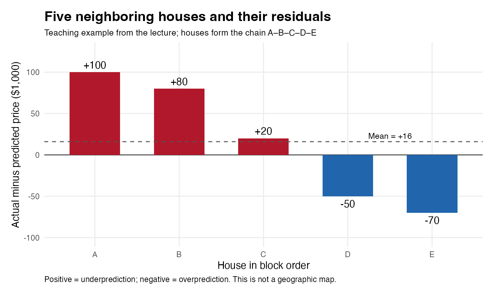
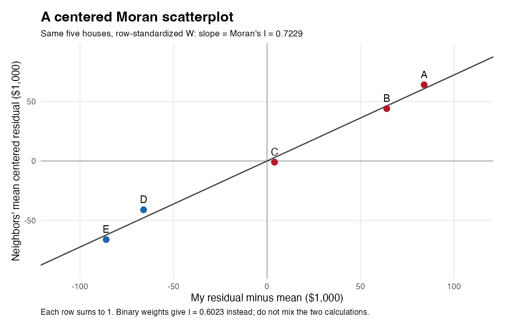

## What We Did

This week's question was **where the model is wrong**, not just how large its
average error is. We moved from tract-level rents to individual house sales,
built local spatial features, mapped residuals, and used Moran's I to measure
whether neighboring homes have similar errors. The lecture then introduced a
Chicago house-price prediction competition with a genuinely held-out test set.

The main source is Dr. Elizabeth Delmelle's *Where Is the Model Wrong?*, dated
October 16, 2026. The supplied classroom photo contains four Week 5–6 review
questions; those are separated from this week's new material below. Numerical
Philadelphia results are lecture outputs, not newly downloaded or re-estimated
sales results. The two figures here reconstruct the lecture's five-house
example; the HTML's linked empirical map and scatterplot images were not supplied.

## 中文复习重点

**一句话：RMSE 告诉你“平均错多少”，残差地图和 Moran's I 告诉你“是不是总在某些地方一起错”。**

| 重点 | 小白理解 | 最容易考错的地方 |
|---|---|---|
| Residual 残差 | 实际房价 − 预测房价 | 正数＝预测偏低；负数＝预测偏高 |
| Buffer count | 以房子为圆心，数一定半径内的事件 | 660 ft 是八分之一英里，不是半英里；先检查 CRS 单位 |
| kNN distance | 找最近的 k 个事件，计算平均距离 | 和“最近的 k 栋房子的残差平均值”不是同一个变量 |
| Spatial lag | 我邻居的数值加权平均 | 行标准化后才是按邻居权重加总的平均，不是时间滞后 |
| Moran's I | 相邻位置的数值是否一起偏高或一起偏低 | 不是 RMSE，也不是解释率；结果依赖邻居和权重定义 |
| Permutation test | 位置不变，把残差重新分配，比较真实 I 是否异常 | p 小不等于效应大，更不等于证明原因 |
| Spatial feature engineering | 把遗漏的地点信息变成 X | 可以用已知设施和环境信息，不能偷看待预测房价 |
| CV versus test | CV 用来选模型，最后保留 test 做独立检验 | 两个 RMSE 差很大是警讯，但不一定就是泄漏 |

学习顺序：先记清残差正负 → 理解“邻居平均” → 看五栋房子的手算 → 理解随机打乱检验 → 把结果用于改进特征。

## Key Concepts

- Prediction quality has both a magnitude and a geography. A low overall RMSE
  can coexist with systematic overvaluation in particular neighborhoods.
- A spatial lag is defined by a neighbor rule and a weight matrix. There is no
  single universal set of neighbors.
- Positive spatial autocorrelation means nearby deviations tend to have the
  same sign. It suggests structure worth investigating, not a proven cause.
- Compare CV RMSE and residual spatial structure on consistent rows, folds,
  units, and weights. A smaller Moran's I alone does not guarantee better prediction.
- Features must be available when a prediction is made. Validation outcomes
  cannot enter feature construction, directly or through their neighbors.

## Notes

### 1. Review of logged predictors and rare factor levels

The worked example is a level–log model, with rent still measured in dollars:

$$
\widehat{rent}=\beta_0+210\log(income).
$$

R's `log()` is the natural logarithm. A 1% increase in income changes predicted
rent by $210\log(1.01)\approx 2.09$ dollars; the usual approximation is
$210/100=2.10$ dollars. A 10% increase gives $210\log(1.10)\approx20.02$ dollars,
not exactly $21. This is an association conditional on included predictors,
not evidence that increasing income causes rent to change.

The marginal slope is $210/income$: the predicted curve rises but becomes
flatter as income rises. **Logging X is not the same as logging Y.**

The error `factor district has new levels Upper Far Northeast` means the
training fold contained no observations in a category present in validation.
The model cannot estimate an effect it never saw. Adding that label to a factor
does not magically estimate its coefficient.

The lecture proposes merging small districts before CV. Use an explicit,
substantively sensible grouping, inspect category coverage in every training
fold, and apply the same mapping to validation and test data. If grouping or
imputation is learned from data, learn it within the training portion; never
use held-out outcomes to design the grouping. Around 150 neighborhoods in the
house example make rare categories particularly relevant.

中文：某个街区只有几套房，恰好全被分到验证组，训练时就没有这个街区。
解决办法是合理合并类别、检查每一折和处理未知类别，不是反复换随机种子直到不报错。

### 2. From census tracts to individual houses

| Dimension | Earlier tract analysis | Week 7 house analysis |
|---|---|---|
| One row | A census tract | A recorded house sale/property record |
| Geometry | Polygon | Point |
| Approximate scale in the lecture overview | About 400 tracts | Tens of thousands of records |
| Count feature | Events within a tract | Events within a buffer around each house |
| Distance feature | Nearest facility | Nearest facility or mean distance to k nearby events |
| Place | Distance to City Hall, district | Distance to City Hall, neighborhood, local environment |

A buffer creates a polygon around a point, so previous spatial-join tools still
apply. Overlapping house buffers may legitimately count the same event more
than once: these are house-specific exposures, not disjoint citywide totals.
Check parcel identifiers and dates; multiple records at one parcel are not
necessarily independent homes, and duplicate locations affect neighbor searches.

### 3. Define which sales belong in the analysis

The lecture queries Philadelphia's `opa_properties_public`, residential
`category_code = '1'`, and sale dates from January 1, 2023 through December 31,
2024 (`sale_date < '2025-01-01'`). Its printed starting count is **37,866**.
The price distribution includes zero and reaches $15,428,633; the median is
$190,000. A recorded transfer is not necessarily an ordinary market transaction.

| Price band, using the source `cut()` boundaries | Lecture count |
|---|---:|
| At most $1,000 | 9,171 |
| More than $1,000 through $10,000 | 199 |
| More than $10,000 through $50,000 | 1,295 |
| More than $50,000 | 27,201 |

These total 37,866. The slide's short labels such as “< $1k” are approximate:
default `cut()` intervals are right-closed, so exactly $1,000 is in the first
band. Family transfers, non-market sales, and ownership changes require
documented eligibility decisions; a price threshold alone does not prove a
transaction was arm's-length.

```r
library(sf)
library(dplyr)
library(ggplot2)

# sales_raw is the sf table returned by the class data-loading step.
# carto_get() in the slides is a course helper, not a base R function.
sales <- sales_raw |>
  st_transform(2272) |>   # Philadelphia; US survey feet
  filter(sale_price >= 10000,
         total_livable_area > 0,
         !st_is_empty(geometry)) |>
  mutate(year_built = na_if(as.numeric(year_built), 0),
         age = 2024 - year_built) |>
  filter(!is.na(age), !is.na(number_of_bathrooms))
```

The lecture reports **27,551** remaining records: 10,315 removed across these
combined rules. It does not provide per-rule drop counts. The `>= 10000`
eligibility rule differs from the `> 10000` boundary between descriptive bands.

Zero year built means unknown in this example, not a 2,024-year-old house.
The fixed reference year 2024 matches the demonstration; age at sale would
instead use each sale's year. Check impossible ages, missing predictor values,
and geometry before fitting. Record exclusions in sequence so drop counts are
interpretable. Do not remove valid expensive houses merely because the curve
is difficult to fit.

### 4. Buffer counts and nearest-neighbor distances

The source defines violent incidents using four assault/robbery labels during
2023–2024. These are the lecture's selected incident categories, not necessarily
every possible definition of violent crime.

```r
# violent: the filtered incident points from the class loading step.
violent <- violent |>
  filter(!st_is_empty(geometry)) |>
  st_transform(st_crs(sales))

stopifnot(st_crs(sales) == st_crs(violent), nrow(violent) >= 5)
sales$violent_660ft <- lengths(
  st_intersects(st_buffer(sales, dist = 660), violent)
)

nearest_events <- nngeo::st_nn(
  sales, violent, k = 5, returnDist = TRUE, progress = FALSE
)
sales$violent_knn5 <- vapply(nearest_events$dist, mean, numeric(1))
```

| Feature | What stays fixed? | What varies? | Interpretation |
|---|---|---|---|
| Buffer count | Radius: 660 feet | Number of incidents | Larger value means more incidents within that radius |
| Mean kNN distance | Number of neighbors: 5 incidents | Search distance | Smaller value means selected incidents are closer |

`st_intersects()` returns matching row indices for each buffer; `lengths()`
counts those indices. `st_nn(..., returnDist = TRUE)$dist` contains a vector
of distances for each house; take the mean of each vector. The
[nngeo documentation](https://michaeldorman.github.io/nngeo/reference/st_nn.html)
distinguishes neighbor indices from returned distances.

660 feet is $660/5280=0.125$ mile. EPSG:2272 uses US survey feet, so a numeric
distance of 660 is appropriate here. For Chicago use the lecture's EPSG:3435,
also in US survey feet; do not reuse a Pennsylvania projection for Chicago.

Counts may be zero when no event falls inside the radius. A kNN distance
generally remains informative beyond that radius, but “never zero” is too
strong: coincident coordinates can produce zero distances. Compare both
representations using the same CV folds. The chosen radius and k are modeling
choices, not automatic truths.

For a real forecasting task, event dates must precede the prediction time.
The lecture's 2023–2024 aggregate is a retrospective demonstration; using
late-2024 incidents to predict an early-2023 sale would introduce future
information into a prospective application.

### 5. Fit a baseline and keep residuals aligned with locations

```r
model_vars <- c("sale_price", "total_livable_area",
                "number_of_bathrooms", "age", "violent_knn5")
model_df <- st_drop_geometry(sales)
ok <- complete.cases(model_df[, model_vars])
ok <- ok & Reduce(`&`, lapply(model_df[, model_vars], is.finite))
sales_model <- sales[ok, ]

m1 <- lm(sale_price ~ total_livable_area + number_of_bathrooms +
           age + violent_knn5,
         data = st_drop_geometry(sales_model), na.action = na.fail)
sales_model$pred <- predict(m1, newdata = st_drop_geometry(sales_model))
sales_model$resid <- sales_model$sale_price - sales_model$pred
```

$$e_i=y_i-\widehat y_i.$$

If a house sells for $350,000 and the model predicts $300,000, its residual is
**+$50,000**: the model underpredicts. If it sells for $250,000 with the same
prediction, its residual is **−$50,000**: the model overpredicts.

Explicitly preparing complete model rows prevents `lm()` from silently
dropping observations while the map still contains every house. Keep a stable
record identifier and never attach a reordered residual vector by position.
These fitted residuals are **in-sample diagnostics**, not CV prediction errors.

### 6. Map errors before reducing them to one number

```r
ggplot(sales_model) +
  geom_sf(aes(color = resid), size = 0.4, alpha = 0.6) +
  scale_color_gradient2(
    low = "#2166ac", mid = "grey90", high = "#b2182b",
    midpoint = 0, limits = c(-300000, 300000), oob = scales::squish
  ) +
  theme_void() +
  labs(color = "Actual - predicted ($)", title = "Where the model is wrong")
```

Under this legend, red is underprediction and blue is overprediction. `alpha`
reduces overplotting. `squish` assigns values outside the displayed color limits
to an endpoint color; it **does not change the residual data or repair the
model**. Keep color limits fixed when comparing models.

A group of neighboring red houses suggests that the model repeatedly misses
something in that area. Possible explanations include omitted amenities,
neighborhood differences, an incorrect functional form, or data problems.
The map does not tell us which explanation is causal. Map held-out errors as
well when evaluating predictive performance.

### 7. Spatial weights and the spatial lag

For a house $i$, let $w_{ij}$ describe how much neighbor $j$ contributes. With
five equally weighted neighbors, each weight is $1/5$ and each row sums to one:

$$
(We)_i=\sum_j w_{ij}e_j
=\frac{e_{j_1}+e_{j_2}+e_{j_3}+e_{j_4}+e_{j_5}}5.
$$

This is a **spatial lag**, meaning neighbors' values, not values from a previous
time period. The house itself is excluded from its neighbor set.

```r
library(spdep)
coords <- st_coordinates(sales_model)
nb <- knn2nb(knearneigh(coords, k = 5))
w_knn <- nb2listw(nb, style = "W")
sales_model$resid_lag <- lag.listw(w_knn, sales_model$resid)
```

Read from the inside out: coordinates → five nearest houses → neighbor list →
weights → weighted residuals. `style = "W"` row-standardizes weights;
`style = "B"` assigns binary weights instead. See
[spdep's weight definitions](https://r-spatial.github.io/spdep/reference/nb2listw.html).

Here kNN finds **neighboring houses for a residual diagnostic**. Earlier kNN
found **nearby crime events for an X feature**. They use the same distance idea
but different objects and purposes. A kNN relationship can also be asymmetric:
A can be among B's nearest neighbors without B being among A's.

Use projected coordinates, inspect duplicated locations, ensure enough distinct
points for the selected k, and construct weights in exactly the same row order
as the residual vector. Changing k changes the spatial question.

### 8. Moran's I and the five-house calculation

Let $z_i=e_i-\bar e$, $n$ be the number of houses, and $S_0=\sum_i\sum_jw_{ij}$.
Then

$$
I=\frac{n}{S_0}\frac{\sum_i\sum_jw_{ij}z_iz_j}{\sum_i z_i^2}.
$$

The numerator compares neighboring deviations. Two positive deviations multiply
to a positive number; so do two negative deviations. Opposite signs multiply
to a negative number. The denominator scales by the overall variation.
This matches the [spdep definition of Moran's I](https://r-spatial.github.io/spdep/reference/moran.html).

The lecture's houses form the chain `A — B — C — D — E`. Only adjacent houses
are neighbors. All amounts below are in **thousands of dollars**.

| House | Residual | Deviation from mean of +16 | Adjacent neighbors | Neighbors' mean residual |
|---|---:|---:|---|---:|
| A | +100 | +84 | B | +80 |
| B | +80 | +64 | A, C | +60 |
| C | +20 | +4 | B, D | +15 |
| D | −50 | −66 | C, E | −25 |
| E | −70 | −86 | D | −50 |



Using **binary weights**, every adjacent pair contributes in both directions:

| Pair | Product of centered residuals |
|---|---:|
| A–B | $84\times64=5,376$ |
| B–C | $64\times4=256$ |
| C–D | $4\times(-66)=-264$ |
| D–E | $(-66)\times(-86)=5,676$ |

There are eight directed links, so $S_0=8$. The numerator is
$2(5376+256-264+5676)=22,088$, and the squared deviations sum to 22,920.

$$I_B=\frac58\frac{22,088}{22,920}=0.6023.$$

**Important distinction:** this hand calculation uses binary weights, whereas
the preceding R example uses row-standardized weights. With row standardization,
the end houses give their single neighbor weight 1, and the three interior
houses give each neighbor weight 1/2. The same five values then give
**$I_W=0.7229$**, not 0.6023.



For row-standardized weights without empty neighbor rows, $S_0=n$. Regressing
the spatial lag of centered residuals on centered residuals gives a slope
equal to Moran's I. With binary weights, that equality requires the $n/S_0$
scaling; do not read an arbitrary lag-scatter slope as I.

中文：A、B 一起偏高，D、E 一起偏低，所以大多数“邻居偏差相乘”是正数。
Moran's I 用一个数概括这种成团。它比较的是减去平均值后的偏差；这个例子的
平均残差不是零，所以不要漏掉减均值这一步。五栋房子是教学例子，不是一个带
截距 OLS 在全部训练样本上的完整残差集合。

### 9. Interpret the statistic and test it by shuffling

| Result | Interpretation | What it does not establish |
|---|---|---|
| Positive I above the random-labeling baseline | Similar deviations tend to be neighbors | A particular omitted variable caused the pattern |
| Near the null baseline | Little global association under this W | No local clusters, no other errors, or a perfect model |
| Negative I below the baseline | Neighboring deviations tend to differ | Necessarily a software mistake |

“Near zero” is a useful large-sample shorthand. Under ordinary random-labeling
conditions, the null expectation is $-1/(n-1)$, not exactly zero; with five
houses it is −0.25. Moran's I is not an ordinary correlation guaranteed to lie
between −1 and +1 for every weight matrix. Interpret its magnitude with its
weights, sample, and null distribution.

```r
set.seed(5080)
mc <- moran.mc(sales_model$resid, w_knn,
               nsim = 499, alternative = "greater")
mc$statistic
mc$p.value
```

Keep locations and weights fixed; randomly reassign the observed residuals
to those locations 499 times. Compare observed I with this reference distribution.
The [spdep permutation test](https://r-spatial.github.io/spdep/reference/moran.mc.html)
defaults to a one-sided `"greater"` alternative; state that alternative.

The lecture reports **I = 0.2605251, p = 0.002** for the Philadelphia model.
These are not the five-house results. With 499 simulations, 0.002 is the smallest
usual one-sided Monte Carlo p-value, $1/(499+1)$; it does not mean the probability
that “there is no clustering” is 0.2%. It indicates unusually large I under the
chosen permutation null. A fitted-residual permutation diagnostic is not a
universal exact test of every regression error assumption.

With many thousands of observations, even modest dependence can be statistically
detectable. Report I as well as p, and inspect maps and held-out prediction
errors. Keep the same W and sample across model comparisons.

### 10. Turn a spatial error pattern into testable features

| Suspected missing information | Candidate feature | Check |
|---|---|---|
| Local amenity or disamenity | Distance to transit, nearby incidents, green-space access | Correct geometry, units, and dates |
| Additive neighborhood differences | Neighborhood fixed effects | Rare categories and unseen levels |
| A relationship varying by location | Interaction, such as area × neighborhood | Enough observations and honest CV |
| An overly rigid functional form | Log or quadratic predictor | Plausible shape and stable held-out improvement |

Refit a candidate, recompute predictions and I, and compare both diagnostics.
Keep a model log with formula, preprocessing, sample size, fold IDs, CV RMSE,
residual type, neighbor rule, I, and a short interpretation. Use “in-sample” or
“out-of-fold” explicitly for the residuals used in Moran's I.

Lower RMSE is better on comparable held-out data. For positive residual
clustering, movement toward the null baseline is a useful improvement; making
I strongly negative is not an objective. A model with tiny I can still make
very large geographically uncorrelated errors. Neighborhood indicators can
reduce in-sample clustering simply by absorbing area means, so independent
prediction checks remain essential.

### 11. Spatial information without target leakage

The lecture contrasts spatial features with the spatial lag model

$$y=\rho Wy+X\beta+\varepsilon.$$

The course rule for this competition is **spatial features of X, not neighboring
target prices**. Crime exposure or transit access can be available for an unsold
home; the final sale prices of its unsold neighbors are not.

For example, if we calculate every house's average neighboring sale price from
the full dataset and only then split into CV folds, a validation home's price
may already be inside a training home's feature. The answer has leaked across
the split. A neighbor-average residual used for diagnosis also uses observed
outcomes; it must not be recycled as an ordinary prediction feature.

This course restriction is not a theorem that all spatial autoregressive
models are incapable of prediction. Specialized out-of-sample methods exist
in [spatialreg](https://r-spatial.github.io/spatialreg/reference/predict.sarlm.html).
They require careful information-set and validation choices. Nor does a
spatial-lag coefficient automatically identify a causal spillover.

Temporal and geographic leakage matter too. Repeated sales of the same parcel
should not accidentally make validation trivial. Random neighboring-house
splits evaluate a different task from predicting entirely new neighborhoods
or future years. Match validation to the intended use and the instructor's
competition protocol.

### 12. Chicago competition workflow and accountability

These are the requirements stated in the **October 16 slides**, not a new
assignment completed in these notes. The slides label this exercise “A4”; it
is distinct in topic from the older tract-analysis file already in this portfolio.
Use the current Canvas handout for the authoritative assignment version.

- Approximately 23,000 single-family sales from 2023–2025, with house features;
  teams construct location features.
- Teams of four; due Friday, October 30, according to this lecture.
- Keep the outcome and reported prediction RMSE in dollars.
- `chicago_train.csv`: about 80% of houses, with prices.
- `chicago_test.csv`: about 20%, without prices; the instructor computes test RMSE.

The workflow is:

1. Load train and test, preserve identifiers and test row coverage, create point
   geometries, and transform to **EPSG:3435**.
2. Document training-sale eligibility and per-rule drop counts. Do not silently
   delete difficult test homes; every required test row needs a prediction.
3. Establish common CV folds and a baseline; learn preprocessing within training
   folds and define missing/unseen-category handling.
4. Inspect residual maps and I. Add defensible spatial features; compare on the
   same folds and record every candidate, not just the winner.
5. Select the model without test prices, refit the chosen pipeline on all eligible
   training data, and generate the requested test predictions.
6. Audit errors across areas and price groups, not only overall RMSE. Explain
   where the model overvalues homes and what that could mean for assessment.

| Slide deliverable | What it should contain |
|---|---|
| Rendered `.qmd` on one teammate's portfolio | Reproducible workflow and interpretation; every teammate links it on Canvas |
| `team_XX_predictions.csv` | Test identifiers and predictions in the required submission format |
| Model log | Every model's CV RMSE and Moran's I, with comparable definitions |
| Failure analysis | Where errors are largest and whose homes are overvalued |

Q7 on October 30 is described as asking each person about their **own team's
model**: features and reasons, CV versus test RMSE, and the worst failures.
Everyone must understand the whole pipeline, even if tasks are divided.

A large CV/test gap is a reason to investigate leakage, overfitting to CV,
sampling variation, distribution shift, or pipeline inconsistencies. It is not
proof of leakage by itself, and one test score is still an estimate on one
sample, not the exact error for all future homes.

## Proving R Works

This executable check uses only the lecture's five-house values. It requires
no sales download or API key, and independently distinguishes the two weights.

```{r}
#| label: week7-numerical-check
r <- c(100, 80, 20, -50, -70)  # thousands of dollars
z <- r - mean(r)
B <- outer(1:5, 1:5, function(i, j) as.numeric(abs(i - j) == 1))
W <- B / rowSums(B)
moran_I <- function(x, weights) {
  centered <- x - mean(x)
  length(x) / sum(weights) *
    sum(centered * (weights %*% centered)) / sum(centered^2)
}
lag_z <- drop(W %*% z)
I_B <- moran_I(r, B)
I_W <- moran_I(r, W)
slope <- unname(coef(lm(lag_z ~ z))[2])
stopifnot(abs(I_W - slope) < 1e-12)
round(c(mean_residual_thousands = mean(r),
        I_binary = I_B, I_row_standardized = I_W,
        scatter_slope = slope,
        log_X_exact_1pct_dollars = 210 * log(1.01)), 4)
```

Expected values: mean = 16; binary I = 0.6023; row-standardized I and scatter
slope = 0.7229; the exact 1% log-income change = $2.0896.

## Classroom Photo Review

The photographed questions review Weeks 5–6, rather than introduce new Week 7
spatial statistics. Their answers are **1 C · 2 B · 3 B · 4 D**.

| Photo question | Correct idea | 中文解释 |
|---|---|---|
| Why ten-fold CV rather than one 80/20 split? | Each record is held out once; performance uses all folds | 减少依赖某一次幸运划分；每折通常用 90% 训练，不是每折用 100%。仍受折划分影响。 |
| CV RMSE = $14,200 for income prediction | Errors have a root-mean-square size of $14,200 | 是美元尺度的误差概括，不是 14.2% 解释率、错误记录数或平方误差之和；也不等于 MAE。 |
| Northwest coefficient = −140, Central is reference | At the same income, Northwest predicted rent is $140 lower | 比较的是 Central，不是全市平均；没有交互时，这是截距差，不是收入斜率差。 |
| Rent rises with income then flattens | Include income and income squared | 负二次项可使斜率在观察范围内逐渐减小。B“删掉最高收入地区”只是把真实规律删掉，没有建模解释弯曲。 |

For the last question,
$\widehat{rent}=\beta_0+\beta_1 income+\beta_2 income^2$ has slope
$\beta_1+2\beta_2 income$. A negative $\beta_2$ allows flattening within the
observed range, but can eventually imply a downturn outside it. `log(income)`
is another possible shape; the photo's option C is **logging rent**, not income.

## English Multiple Choice Quiz

These are practice questions based on Week 7, not confirmed exam questions.
Each has one best answer. 先做题，后看答案和中文解析。

### Q1. Reading a residual

A home sells for $280,000 and the model predicts $320,000. What is its residual?

- A. +$40,000; the model underpredicts.
- B. −$40,000; the model underpredicts.
- C. −$40,000; the model overpredicts.
- D. +$40,000; the model overpredicts.

### Q2. Reading a logged predictor

In `rent ~ log(income)`, the log-income coefficient is 210 and rent is in dollars.
A 1% income increase is associated with approximately:

- A. $2.10 more rent.
- B. $210 more rent.
- C. 210% more rent.
- D. 1% more rent.

### Q3. Buffer counts

House coordinates use a projected CRS in US survey feet. What does
`lengths(st_intersects(st_buffer(houses, 660), incidents))` return?

- A. The nearest incident's distance in meters.
- B. The number of incidents within each house's 660-foot buffer.
- C. The average price of the five nearest houses.
- D. The number of incidents within half a mile of each house.

### Q4. Spatial lag

A house has three equally weighted neighbors with residuals of +30, −10, and
+10 thousand dollars. What is its row-standardized spatial lag?

- A. +30 thousand dollars.
- B. −10 thousand dollars.
- C. +50 thousand dollars.
- D. +10 thousand dollars.

### Q5. Positive Moran's I

A residual Moran's I is clearly above its random-labeling baseline. What is the
best interpretation?

- A. The model's RMSE is necessarily low.
- B. Nearby houses tend to have similar centered residuals.
- C. The model has proved that crime causes house prices.
- D. The model explains I percent of the variance in prices.

### Q6. Permutation testing

What does `moran.mc(residuals, weights, nsim = 499)` randomize?

- A. The observed residual values across the fixed locations.
- B. The geographic coordinates of every house.
- C. The units of the response variable.
- D. The observed prices by fitting 499 new regression models.

### Q7. Small p-values

The lecture reports I = 0.2605 and p = 0.002. Which statement is most appropriate?

- A. There is a 0.2% probability that the null hypothesis is true.
- B. The model's price predictions are wrong by 0.2605 dollars.
- C. The chosen test detects positive clustering; magnitude and prediction error still matter.
- D. Neighborhood amenities have been established as the cause.

### Q8. Comparing weights

Why can the five-house example give I = 0.6023 with binary weights and I = 0.7229
with row-standardized weights?

- A. Row standardization changes the sale prices.
- B. One of the calculations must be a software bug.
- C. The sample contains different houses in each calculation.
- D. The relative contributions of neighbors change, especially at the chain's ends.

### Q9. Data leakage

Which feature construction most directly leaks held-out target information?

- A. Distance from each home to a known train station.
- B. Mean neighboring sale price computed using all prices before CV splitting.
- C. A buffer count of events known before the prediction date.
- D. House age computed from a recorded construction year.

### Q10. New factor levels

A validation fold contains a neighborhood absent from its training fold. What
is the best response?

- A. Assign an arbitrary coefficient of zero and report no limitation.
- B. Add validation prices to the training set.
- C. Use a documented category strategy and verify coverage and unseen-level handling.
- D. Treat the error as proof that all categorical predictors are useless.

### Q11. Honest model comparison

Two models use the same rows and folds. A has CV RMSE $60,000 and residual I 0.01;
B has CV RMSE $45,000 and residual I 0.10. Which conclusion is supported?

- A. B predicts more accurately by this RMSE, but its remaining spatial pattern deserves investigation.
- B. A must be preferred because Moran's I is the only prediction metric.
- C. Neither result can be interpreted without a significant coefficient p-value.
- D. B cannot be used because positive I proves leakage.

### Q12. A real test set

The Chicago test file has predictors but no prices. What should the team do?

- A. Select features by repeatedly checking the hidden test prices.
- B. Delete difficult test homes to reduce RMSE.
- C. Use in-sample training RMSE as the final test RMSE.
- D. Select with training-set CV, refit on training data, and submit predictions for all required test homes.

## Answer Key and Chinese Explanations

答案速查：**1 C · 2 A · 3 B · 4 D · 5 B · 6 A · 7 C · 8 D · 9 B · 10 C · 11 A · 12 D**。

1. **C：实际减预测。** $280000-320000=-40000$，模型预测比实际贵，所以是高估。
2. **A：X 取 log，Y 不取 log。** 1% 的 X 变化大约对应 $\beta/100$ 美元的 Y 变化。精确值是 $210\log(1.01)=2.0896$。
3. **B：数缓冲区内的事件。** `st_buffer()` 画圈，`st_intersects()` 找匹配事件，`lengths()` 数个数。660 英尺＝0.125 英里，半英里是 2,640 英尺。
4. **D：邻居平均值。** $(30-10+10)/3=10$。不能只求和，也不把自己的残差再加进去。
5. **B：相邻位置往往一起偏高或一起偏低。** Moran's I 不是误差金额或解释率；空间聚集也不直接说明是哪个变量造成的。
6. **A：位置和权重不动，残差重新分配。** 问的是：如果残差与位置没有这种关联，随机打乱后能否得到同样大或更大的 I？并不是每次重新拟合回归。
7. **C：统计显著、实际大小、预测准确性分开看。** p 值不是零假设为真的概率；样本很大时很小的空间关系也可能显著。I 不是美元。
8. **D：权重定义变了。** 二元权重中每条边权重为 1；行标准化时，中间房子的两个邻居各占 1/2，端点的唯一邻居占 1。样本和残差不变，I 仍会变。
9. **B：验证答案通过邻居进入特征。** 先用全体房价构造邻居均价，再分折，已经泄漏了验证集信息。本次课程要求使用空间 X，不使用邻近目标房价。
10. **C：解决信息缺失，而不只消除报错。** 合理合并稀有类别并检查每折；只补 factor 标签无法学出不存在的街区系数。不能偷加验证价格。
11. **A：B 的留出误差较小，但仍有空间结构。** RMSE 衡量预测误差大小，I 衡量地理结构，两者不可互相替代。也要确认两次 I 使用同类残差和同一权重。
12. **D：CV 选模型，test 做最后独立检验。** 训练集上确定流程，再对全部必需测试记录预测。随意删除难预测房屋会改变评估对象，也可能违背提交要求。

## Reflection

An error map changes the question from “Is this model accurate on average?” to
“Who and where does this model systematically miss?” Moran's I helps formalize
that question, but cannot replace honest validation or identify a causal
mechanism. The practical loop is to inspect errors, propose a defensible
feature, compare held-out performance, and document the remaining limitations.

## Questions I Still Have

- How much would a random-fold model deteriorate when predicting a new neighborhood
  or a later year?
- Can a model reduce overvaluation among cheaper homes without making average
  dollar error worse, and which evaluation would reveal that tradeoff?

## Sources and Scope

- Dr. Elizabeth Delmelle, *Where Is the Model Wrong?*, Week 7 lecture,
  October 16, 2026, supplied as `week7_slides.html`.
- Supplied classroom photo of four review questions on CV, RMSE, factor
  coefficients, and quadratic features; summarized separately above.
- Official documentation linked beside the relevant `nngeo`, `spdep`, and
  `spatialreg` explanations.
- The figures use the exact five-house teaching values and are reproducible
  with `weekly-notes/assets/generate-week7-figures.R`. They do not substitute
  invented Philadelphia sales data for the missing empirical figure files.
- Code outside “Proving R Works” is a study template requiring the named class
  data and installed packages. The numerical check is executed during rendering.
