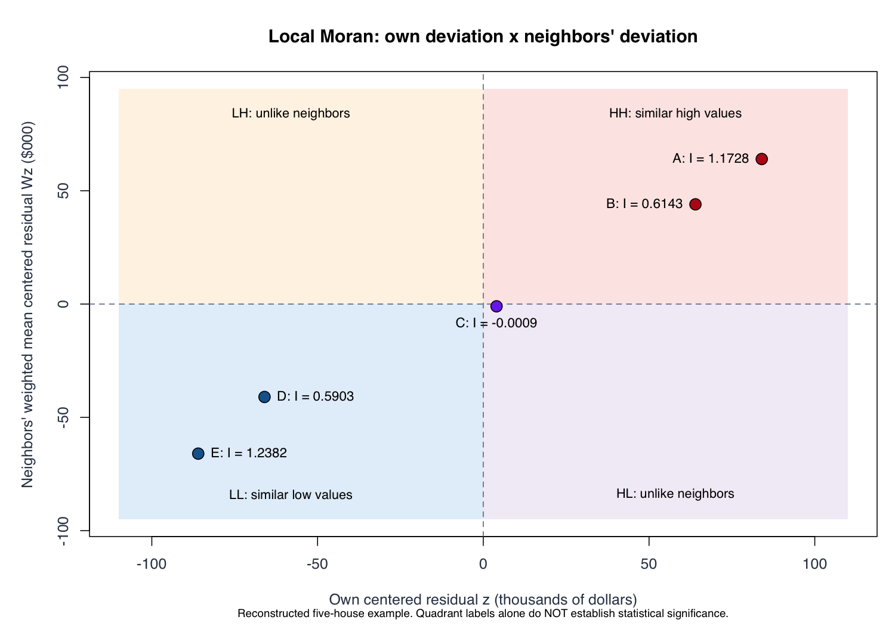
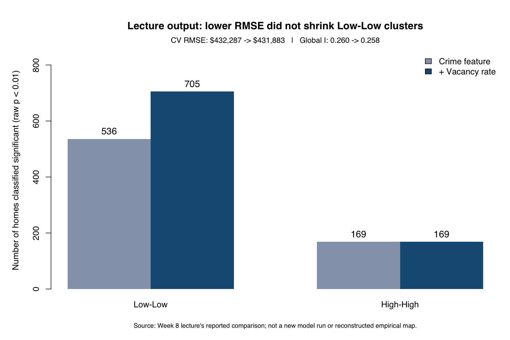

## What We Did

Week 7 asked whether prediction errors cluster. Week 8 asks **where they
cluster, what features might explain the pattern, and what happens when a
prediction system is used to make housing decisions**.

These notes follow Dr. Elizabeth Delmelle's *A few odds & ends: LISA, the case
of RealPage, etc.* (October 23, 2026). They expand my original Joplin reminders
about LISA, Queen/Rook neighbors, row standardization, and the five-house table.
Peer Week 8 notes by [CyannnZ](https://github.com/CyannnZ/MUSA-5080-portfolio/blob/main/weekly-notes/week-08.qmd)
and [terbear15](https://github.com/terbear15/MUSA-5080-portfolio/blob/main/weekly-notes/week-08.qmd)
were consulted for coverage, not treated as authoritative answers.

The supplied HTML refers to a Philadelphia LISA map whose image file was not
included. The figures below therefore reconstruct the numerical teaching
example and the lecture's comparison table—not the missing empirical map.
The Assignment 5 section describes the current **NS** submission on October
29, 2026, not an earlier m10 version or the Philadelphia lecture model.

## 中文复习重点

**一句话：先看模型错多少，再看在哪里一起错，最后问这种错误和模型的使用方式会伤害谁。**

| 核心概念 | 小白理解 | 考试陷阱 |
|---|---|---|
| Global Moran's I | 整张地图的相邻数值是否相似 | 不能告诉你具体哪一块有问题 |
| Local Moran's I / LISA | 一栋房子与它邻居的偏差是否一起高或低 | 大的正数既可能 HH，也可能 LL |
| HH / LL | 自己和邻居都在平均残差的同一侧 | High/Low 相对平均值，不一定相对零 |
| HL / LH | 自己和邻居在平均残差的不同侧 | 是空间离群候选，不是自动的数据错误 |
| Permutation p-value | 这种邻居组合在随机情况下有多不寻常 | p 小不代表误差金额大，也不证明原因 |
| OOF residual | 用没训练过这条记录的模型计算误差 | 不是全样本拟合后的训练残差 |
| Feature engineering | 把“附近”变成可计算、预测时可得的 X | 不可使用验证/测试房价或邻居残差泄漏答案 |
| Equity audit | 比较不同地区、收入组是否持续被高估 | 总体 RMSE 下降，不保证各组都改善 |
| Governance | 谁提供数据、谁决策、谁承担后果 | 准确率高也不能自动证明系统合法或公平 |

学习顺序：残差正负 → 定义邻居 → 中心化和邻居平均 → Local I → 显著性 →
提出可验证的新特征 → 固定验证条件重新比较 → 检查公平性与使用规则。

## Key Concepts

- **Residual = actual − predicted.** Positive means underprediction; negative
  means overprediction. LISA quadrants instead use deviations from the mean.
- A local statistic requires a neighbor definition, weight convention,
  variance convention, and inference procedure. Always report these choices.
- A cluster map is a diagnostic starting point, not a causal explanation.
- Compare models on the same observations, folds, units, and spatial weights.
  Consider error size, spatial structure, subgroup results, and implausible predictions.
- Predictive performance and acceptable deployment are separate questions.

## Notes

### 1. Global versus local: a citywide score versus a house-by-house diagnosis

Global Moran's I summarizes the whole pattern. A positive value suggests nearby
deviations tend to resemble one another. It does not identify the locations.
Local Moran's I, one statistic per observation, highlights candidate clusters
and spatial outliers. LISA means **Local Indicators of Spatial Association**;
local Moran's I is one member of that family.

Think of the global score as “this class has a common problem” and local scores
as “these groups of students need closer inspection.” Neither tells us the
cause by itself. A global value near its randomization expectation can also
hide local patterns that cancel one another.

### 2. Define neighbors before calculating anything

My original board notes mention Queen and Rook. For **polygons**:

| Neighbor position around X | Rook | Queen |
|---|---|---|
| Shares an edge: above, below, left, right | Yes | Yes |
| Only shares a corner: four diagonals | No | Yes |
| No common edge or vertex | No | No |

For house **points**, k-nearest neighbors or a distance threshold is more
natural than polygon contiguity. Do not confuse “five nearby houses used to
compare residuals” with “five nearby robberies used to build a predictor.”

A binary weight is 1 for a neighbor and 0 otherwise; the diagonal is normally
0 because a house is not its own neighbor. Row standardization divides each
weight by that row's sum:

$$w_{ij}=b_{ij}/\sum_j b_{ij}.$$

One neighbor gets weight 1; two get 1/2 each; five get 1/5 each. Each nonempty
row sums to 1, so the spatial lag is a weighted neighbor average. This does not
make unequal neighbor distances equal in reality; it defines their weights.
An isolated observation needs an explicit policy. Changing the policy or W
changes the diagnostic. Row standardization can make W asymmetric even when
the original neighbor relation is symmetric.

### 3. Complete five-house example: every number accounted for

The houses form a chain: **A—B—C—D—E**. Residuals are in thousands of dollars.

$$e=(100,80,20,-50,-70),\qquad \bar e=16.$$

Center each residual: $z_i=e_i-\bar e$. Here $z$ means a **centered value**,
not a value divided by a standard deviation.

The row-standardized weight matrix is:

| From / to | A | B | C | D | E |
|---|---:|---:|---:|---:|---:|
| A | 0 | 1 | 0 | 0 | 0 |
| B | 0.5 | 0 | 0.5 | 0 | 0 |
| C | 0 | 0.5 | 0 | 0.5 | 0 |
| D | 0 | 0 | 0.5 | 0 | 0.5 |
| E | 0 | 0 | 0 | 1 | 0 |

| House | Residual e | Centered z | Neighbors | Weighted neighbor z | z × neighbor z | Local I |
|---|---:|---:|---|---:|---:|---:|
| A | 100 | 84 | B | 64 | 5,376 | 1.1728 |
| B | 80 | 64 | A, C | 44 | 2,816 | 0.6143 |
| C | 20 | 4 | B, D | −1 | −4 | −0.0009 |
| D | −50 | −66 | C, E | −41 | 2,706 | 0.5903 |
| E | −70 | −86 | D | −66 | 5,676 | 1.2382 |

The common denominator is:

$$
\sum_i z_i^2=84^2+64^2+4^2+(-66)^2+(-86)^2=22,920,
\qquad m_2=22,920/5=4,584.
$$

The local formula used here is:

$$I_i=\frac{z_i}{m_2}\sum_j w_{ij}z_j.$$

For B, its neighbors' average is $(84+4)/2=44$, so
$I_B=64\times44/4584=0.6143$.
For C, it is $(64-66)/2=-1$, so $I_C=-4/4584\approx-0.0009$.
The slide rounds C to 0.00; its unrounded sign is slightly negative.

中文：先看自己偏离平均多少，再看邻居平均偏离多少；同号相乘为正，异号为负。
最后除以全体偏差的共同尺度，才能比较不同位置。Local I 可以大于 1，
所以 A 的 1.1728 和 E 的 1.2382 并不是算错了。

#### Connection to last week's 5/8 and 0.7229

Global Moran's I is:

$$I=\frac{n}{S_0}\frac{\sum_i z_i\sum_jw_{ij}z_j}{\sum_i z_i^2},
\qquad S_0=\sum_i\sum_jw_{ij}.$$

Binary chain weights count eight directed links, so $n/S_0=5/8$. After row
standardization, the five rows each sum to 1; $S_0=5$ and $n/S_0=1$.
The numerator also changes—do not change only the prefactor.

$$I=(5376+2816-4+2706+5676)/22920=16570/22920=0.7229.$$

With the same centered data, W, and $m_2=\sum z_i^2/n$,
$I=\sum_i I_i/S_0$. Thus, in this no-isolate row-standardized example,
**global I equals the mean of the five local I values**. The binary result
is approximately 0.6023. These are different weighting conventions, not two
roundings of the same calculation.

### 4. The four quadrants: what is high, and relative to what?



| Type | Own centered residual z | Neighbor lag Wz | Sign of local I | Descriptive meaning |
|---|---|---|---|---|
| High–High (HH) | + | + | + | Above-average residual beside above-average residuals |
| Low–Low (LL) | − | − | + | Below-average residual beside below-average residuals |
| High–Low (HL) | + | − | − | Above-average residual beside below-average neighbors |
| Low–High (LH) | − | + | − | Below-average residual beside above-average neighbors |

“High” refers to the **residual**, not necessarily an expensive house. A $1m
house can have a low residual if the prediction is too high.

**Critical distinction:** raw residuals use zero to distinguish under- and
overprediction; quadrants use the mean residual. In this example C has a raw
residual of +20 and neighbors with raw mean +15: both are underpredicted.
Yet C is descriptively HL because +20 is above the overall mean +16 and +15
is below it. In OOF predictions, the residual mean need not be exactly zero.
Interpret HH as underprediction and LL as overprediction only after checking
the raw residuals and the centering baseline.

The five houses' quadrant descriptions are HH, HH, HL, LL, LL. **No local
significance tests were supplied for this toy table.** We cannot call the
points statistically significant merely from their quadrant or I value.
A zero on either axis is a boundary case, not automatically LH.

### 5. Local permutation tests and multiple comparisons

The lecture uses `localmoran_perm()` with **499 simulations**, then displays
quadrants passing **raw p < 0.01**. Conceptually, keep the focal observation
fixed and compare its observed neighbor association with randomized
arrangements under the chosen conditional null. Check the simulation-based
p-value column rather than confusing it with I, a z statistic, or a
normal-approximation p-value. The [spdep documentation](https://r-spatial.github.io/spdep/reference/localmoran.html)
also documents the default denominator n and alternative hypotheses.

What a small p-value does and does not say:

- It indicates evidence against the specified randomization null for that
  location and W; it is not the probability that the null is true.
- It does not measure dollar error, prove an omitted feature caused the
  pattern, or prove unfair treatment of an individual household.
- With thousands of local tests, raw p < 0.01 is not a map-wide error-rate
  guarantee. A BH-adjusted sensitivity analysis is useful, with the dependence
  assumptions and chosen adjustment reported; do not silently replace the
  lecture's unadjusted results with adjusted ones.
- More simulations improve p-value resolution and stability. Neither more
  simulations nor a stricter threshold fixes a poorly chosen neighbor rule.

不显著的意思是“按当前检验，没有足够证据标出它”，不是“证明没有空间结构”。
同样，显著也不是“找到原因了”。

### 6. Honest workflow: out-of-fold residuals first

For each fold, train on the other folds and predict the held-out observations.
Collect exactly one held-out prediction per row, then compute
$e_i=y_i-\hat y_i^{OOF}$. A model fitted on all rows followed by
`residuals(model)` gives **in-sample**, not OOF, errors.

Keep a stable ID and order. Build W for the same retained records in precisely
the same order as the residual vector. If missing rows are dropped, rebuild
or correctly subset the weights; equal lengths alone do not prove alignment.
Keep repeated properties together when that is the validation design.

The lecture's `cv_pred()` is a custom helper, not a base-R function. This
minimal teaching helper shows the principle for **numeric predictors only**:

```r
oof_numeric <- function(data, outcome, predictors, fold_id) {
  stopifnot(length(fold_id) == nrow(data), !anyNA(fold_id),
            all(is.finite(data[[outcome]])),
            all(vapply(data[predictors], is.numeric, logical(1))))
  pred <- rep(NA_real_, nrow(data))
  for (k in unique(fold_id)) {
    train <- data[fold_id != k, , drop = FALSE]
    valid <- data[fold_id == k, , drop = FALSE]
    for (v in predictors) {
      med <- median(train[[v]][is.finite(train[[v]])])
      if (!is.finite(med)) stop(paste("No usable training values:", v))
      train[[v]][!is.finite(train[[v]])] <- med
      valid[[v]][!is.finite(valid[[v]])] <- med
    }
    fit <- lm(reformulate(predictors, response = outcome), data = train)
    pred[fold_id == k] <- predict(fit, newdata = valid)
  }
  stopifnot(all(is.finite(pred)))
  pred
}
```

This is not a replacement for the assignment's factor-handling pipeline.
Categorical levels, transformations learned from data, and other preprocessing
also need a training-only strategy. The lecture's full-table median fill for
vacancy should be moved **inside** each training fold for honest CV.

An illustrative LISA template, once `sales` and fixed `fold_id` exist:

```r
library(sf)
library(spdep)
library(dplyr)

# sales must have valid point geometry and complete observed sale_price.
# Use a suitable local projected CRS; EPSG:2272 is Philadelphia, US survey feet.
s <- st_transform(sales, 2272)
stopifnot(!anyDuplicated(s$id))
s$pred_oof <- oof_numeric(st_drop_geometry(s), "sale_price",
                         c("building_area", "age"), fold_id)
s$residual <- s$sale_price - s$pred_oof

# Duplicate coordinates require an explicit, consistent neighbor policy.
xy <- st_coordinates(s)
nb <- knn2nb(knearneigh(xy, k = 5), row.names = as.character(s$id))
w <- nb2listw(nb, style = "W")
stopifnot(identical(attr(w$neighbours, "region.id"), as.character(s$id)))

set.seed(5080)
loc <- localmoran_perm(s$residual, w, nsim = 499,
                       alternative = "two.sided", mlvar = TRUE)
p_col <- "Pr(z != E(Ii)) Sim"
stopifnot(p_col %in% colnames(loc))
s$local_I <- loc[, "Ii"]
s$p_raw <- loc[, p_col]
s$p_BH <- p.adjust(s$p_raw, method = "BH") # optional sensitivity result
s$z <- s$residual - mean(s$residual)
s$lag_z <- lag.listw(w, s$z)
s$quadrant <- case_when(
  s$z > 0 & s$lag_z > 0 ~ "HH",
  s$z < 0 & s$lag_z < 0 ~ "LL",
  s$z > 0 & s$lag_z < 0 ~ "HL",
  s$z < 0 & s$lag_z > 0 ~ "LH",
  TRUE ~ "On axis / undefined"
)
s$lisa <- case_when(
  is.na(s$p_raw) ~ "Undefined",
  s$p_raw < 0.01 ~ s$quadrant,
  TRUE ~ "Not significant"
)
```

This template is not executed against private sales here and does not
reproduce the missing Philadelphia map. For spatially separated future
locations, spatial-block CV may be more appropriate than random folds;
validation should resemble the intended deployment.

### 7. What the lecture's Philadelphia results actually show

Reported initial significant categories at raw p < 0.01:

| HH | HL | LH | LL | Not significant | Total |
|---:|---:|---:|---:|---:|---:|
| 169 | 22 | 121 | 536 | 26,692 | 27,540 |

These are **lecture outputs**, not results rerun for these notes. Their total
is 27,540, not the 27,551 clean observations reported in Week 7. The supplied
HTML does not explain the 11-row difference; do not invent a filtering reason.

The lecture joins 2023 ACS median household income (`B19013_001`) and groups
sales by income quintile. The table has 27,248 income-matched observations:

| Income quintile | Homes | LL percentage | HH percentage |
|---|---:|---:|---:|
| Q1, lowest | 5,450 | 4.48% | 0.257% |
| Q2 | 5,450 | 2.04% | 0.404% |
| Q3 | 5,450 | 1.45% | 0.294% |
| Q4 | 5,449 | 1.12% | 1.38% |
| Q5, highest | 5,449 | 0.459% | 0.752% |

Read the denominator: these are percentages **within each income group**,
not percentages of all LL houses. Quintiles formed after the house–tract join
contain roughly equal numbers of houses, not equal numbers of tracts.
`ntile()` may split ties. Tract median income describes an area, not the
personal income of every homeowner.

LL is a flag to inspect raw negative residuals. If a valuation model systematically
overvalues low-price homes and those values determine assessments, there is a
potential disproportionate tax burden. This table is not an actual tax-bill
calculation: exemptions, assessment rules, tax rates, and other factors matter.

For joins, verify point-in-polygon matches, unmatched records, and duplicates.
`st_nearest_feature()` returns the nearest feature's index; it does not prove
that a house lies inside that tract. A nearest-tract fallback needs inspection.

### 8. Three ways to operationalize “near”

| Feature | Question answered | What is fixed? | Main sensitivity |
|---|---|---|---|
| Count in a 660-ft buffer | How many events are close by? | Radius | Events just inside/outside cutoff; zeros |
| Distance to nearest event | How far to the closest one? | k = 1 | A single event can dominate |
| Mean distance to 5 nearest events | How close is a small local set? | k = 5 | Search radius expands in sparse areas |

**660 ft = 1/8 mile**, not 1/2 mile. Check CRS units before a buffer.
Philadelphia EPSG:2272 and Chicago EPSG:3435 use US survey feet; neither is a
universal CRS. Longitude/latitude degrees are not feet. The following templates
assume both layers are already in the same suitable projected, feet-based CRS:

```r
# Count, including zero when a buffer has no matches
crime_n660 <- lengths(st_intersects(st_buffer(homes, 660), crime))

# Closest geometry's index is not itself a distance
j <- st_nearest_feature(homes, crime)
near_ft <- as.numeric(st_distance(homes, crime[j, ], by_element = TRUE))

# Mean of the five returned distances (requires >= 5 crime records)
nn <- nngeo::st_nn(homes, crime, k = 5, returnDist = TRUE)
mean5_ft <- vapply(nn$dist, mean, numeric(1))
```

Verify the distance units returned by each method, especially if using a
geographic CRS. In `nngeo`'s point-search implementation, geographic coordinates
use geodesic distances in meters; projected points use their coordinate units
(checked with the installed implementation). The [function documentation](https://michaeldorman.github.io/nngeo/reference/st_nn.html)
labels distances generically as meters, so do not infer units from a variable
name alone. Missing coverage is **not**
the same as a verified zero count.

Logging a positive distance captures relative changes: 100→500 is a fivefold
change; 5,000→5,400 is only an 8% increase, despite the same 400-unit difference.
But exact coincident coordinates can give distance zero. `log(0)` is undefined.
Use a defensible zero policy, e.g. `log1p(distance_ft)`, and record the unit and
offset. Changing feet to meters is not innocuous inside `log1p()`.

### 9. Compare spatial features without moving the goalposts

The lecture's reported CV RMSE values are:

| Crime representation | CV RMSE ($) |
|---|---:|
| Mean distance to 5 nearest | 432,287 |
| Nearest distance | 432,295 |
| Log mean distance to 5 nearest | 432,300 |
| Buffer count | 432,314 |

The full spread is only $27 against about $432,000 of error. The first is the
smallest reported number, but this is not compelling evidence of a robust
winner without paired fold differences or other uncertainty checks.
Use the **same rows, folds and preprocessing** for comparison.

Choose a small, substantively motivated shortlist of radii/k values. Repeatedly
trying many options on the same CV folds can overfit the selection process.
An untouched final test or nested validation is needed for an independent
performance assessment after extensive tuning.

### 10. Vacancy experiment: a hypothesis, not a guaranteed fix

The lecture adds a tract-level vacancy percentage:

$$vacancy\_pct=100\times\frac{B25002\_003}{B25002\_001}.$$

The numerator is vacant housing units; the denominator is all housing units.
Guard against missing or zero denominators. A missing rate is not automatically
0%. If imputing, learn the median from training-fold observations only.

| Lecture model | CV RMSE ($) | Global residual I | Significant LL | Significant HH |
|---|---:|---:|---:|---:|
| Crime feature | 432,287 | 0.260 | 536 | 169 |
| + Vacancy | 431,883 | 0.258 | 705 | 169 |



RMSE falls by $404 (about 0.093%), and global I decreases by 0.002. But LL
**increases by 169**, approximately 31.5%; HH stays unchanged. It would be
incorrect to write “adding vacancy shrank the blue clusters.” Counts also
depend on the threshold, residual distribution and local inference; a
count change is not itself a measure of how many dollars the model improved.

Conclusion: this specification provides no clear evidence that it solved
the targeted local pattern. It does not prove vacancy is causally irrelevant.
Inspect the same locations' raw errors and local statistics, not only totals.

The improvement loop is: **OOF predictions → residual map/global I → local
diagnosis → plausible missing X → fixed-fold comparison → local and subgroup
checks**. Residuals identify questions; they are not allowed to sneak into the
predictors for the same held-out houses.

### 11. RealPage: prediction is not the whole policy question

The class moves from statistical diagnostics to algorithmic rent recommendations.
Ask three things:

1. **What data, supplied by whom?** Public listings, a landlord's own leases,
   and rivals' nonpublic rents/occupancy have different implications.
2. **Who acts, and who can say no?** Optional advice differs from a default
   acceptance workflow that makes overrides difficult.
3. **Who bears the consequences?** Landlords, tenants, and neighborhoods may
   experience different outcomes even when the prediction is accurate.

A model can predict rents well yet support a problematic coordination process.
Revenue maximization is an objective chosen by people, not a neutral definition
of public benefit. Conversely, an algorithm's existence alone does not establish
an antitrust violation; data, conduct, incentives and applicable law matter.

**Dated legal-source check, October 29, 2026:** DOJ's November 24, 2025
[announcement](https://www.justice.gov/opa/pr/justice-department-requires-realpage-end-sharing-competitively-sensitive-information-and)
describes a **proposed** RealPage settlement with restrictions on competitor
nonpublic data, a minimum 12-month age for specified training data, geographic
effects, price-alignment features and a monitor. The DOJ
[case page](https://www.justice.gov/atr/case/us-and-plaintiff-states-v-realpage-inc)
still lists RealPage's proposed judgment; its March 2026 final judgment is for
Greystar. These inspected sources do not establish a final RealPage judgment,
so these notes do not repeat the slide's “approved” wording as verified fact.
Those terms must not be generalized into a universal ban on block-level GIS.

Philadelphia City Council's [October 24, 2024 notice](https://phlcouncil.com/councilmember-orourkes-algorithmic-rental-price-fixing-ban-passes-council-heads-to-mayor-parkers-desk/)
confirms passage of Bill 240823, targeting rental price-fixing. The separate
resolution 240862 calling for state action is not that ordinance. This is a
classroom policy summary, not advice about a particular deployment's legality.

### 12. The classroom RFP: accept, modify or decline?

The **fictional classroom** client is a consortium of nine landlords with
about 28,000 apartments. The brief offers a $1.8m build budget and $40,000 per
month, with selection weighted 40% price, 40% projected revenue and 20%
technical quality. Students review eight requirements and defend a proposal.
These are exercise facts, not real contract commitments.

| Requirement | What it asks | A defensible response to discuss |
|---|---|---|
| R1 | Unit-level estimates using public data | Accept with data rights, validation and uncertainty checks |
| R2 | Pool members' current confidential rent rolls | Decline this cross-competitor pooling; use a reviewed, segregated alternative |
| R3 | Daily asking-rent and renewal recommendations | Modify to auditable decision support, with compliance review |
| R4 | Default acceptance; overrides need approval | Modify to meaningful human review and documented discretion |
| R5 | Block-level geography | Review permitted data/use; fine geography is not inherently wrong, but may create coordination or privacy risks |
| R6 | Revenue prioritized over occupancy | Add occupancy, turnover and tenant-impact guardrails; disclose objective tradeoffs |
| R7 | Neighborhood benchmarks against other consortium members | Avoid exposing rivals' sensitive behavior; consider public or own-history benchmarks |
| R8 | Strict secrecy beyond legally required disclosures | Preserve lawful oversight, independent audit and clear accountability |

These are suggested design judgments, not the professor's official answer
key. A strong pitch explains the red line, the alternative product, remaining
uncertainty, and conditions of delivery—not merely “we will be ethical.”
Public-facing defensibility and winning the client's revenue-based score may
not select the same proposal.

## Connection to Assignment 5: the current North/South model

### A. What the assignment is testing

Predict **Chicago house sale prices**, then explain the model and audit its
errors. It is not the Philadelphia lecture's rent model. A convincing workflow
combines structural attributes, spatial features, honest CV, residual spatial
diagnostics, subgroup checks, and a complete test prediction file.

The current working report is `MUSA-PPA-assignment/assign5.qmd`. The numbers
below were checked against its saved `model_log.csv` and `model_comparison.csv`
on October 29, 2026. They are recorded run results, not a fresh rerun here.

- Supplied training rows: **23,200**; retained analysis rows: **21,968**.
  The 1,232 exclusions are flagged multi-parcel sales, not a blanket deletion
  of expensive houses. The configured low-price/invalid-area/coordinate
  screens removed no additional rows in this supplied sample.
- All **5,789 test rows** remain, including flagged multi-parcel observations.
  Training exclusions do not justify losing requested test IDs.
- The same fixed **10 folds**, seed 5080, group identical coordinates together.
  Models use identical rows and five-neighbor row-standardized weights.
- Imputation medians are learned inside each training fold. Predictors do not
  use held-out prices, neighboring prices, or residuals.

### B. Why each feature family matters

| Feature family | Examples in this submission | Reason and caution |
|---|---|---|
| Structure | Building area, age, beds/baths, garage, AC, basement | Basic property differences; coefficients are conditional associations |
| Nonlinearity | Building-area², age², log lot area | Allows changing slopes; still linear in coefficients |
| Time | Sale year and quarter | Captures observed period differences, not guaranteed future trends |
| Location | Downtown distance and its square, east/north coordinates, Ward | Allows systematic geographic differences |
| Interactions | Building area × Ward, building area × age | Allows a feature's slope to differ by location or age |
| Crime exposure | 660-ft count, mean distance to five robberies, logs, coverage flag | Uses exposure before sale; missing data coverage is not zero crime |
| Final NS adjustment | North/South indicator + log lot × zone | Allows a different baseline and lot-area slope across the boundary |

The final **NS model is one OLS model**, not two separately fitted regional
models. Its boundary is `north_mi = 0` relative to the downtown reference.
With South as an illustrative reference, an interaction has the form:

$$\hat y=\cdots+\beta_L\log(lot)+\beta_N North+
\beta_{LN}\log(lot)\times North.$$

South's log-lot slope is $\beta_L$; North's is
$\beta_L+\beta_{LN}$. Their price difference at a particular lot size is
$\beta_N+\beta_{LN}\log(lot)$, **not always just $\beta_N$**. Check the actual
factor reference level before interpreting fitted coefficients.

### C. Accuracy, spatial clustering, and implausible predictions

| Saved model | Mean-fold CV RMSE ($) | Pooled OOF RMSE ($) | Residual Moran's I | Negative test predictions |
|---|---:|---:|---:|---:|
| m1: structural baseline | 281,468 | 282,189 | 0.3773 | 34 |
| m10: previous full model | 181,295 | 182,182 | 0.1710 | 12 |
| NS: selected final model | **179,512** | **180,385** | **0.1642** | **2** |
| E3: Ward-specific lot slope | 175,758 | 176,527 | 0.1451 | 6 |

NS improves mean-fold RMSE by about **0.98% versus m10** and **36.22% versus
m1**. Positive residual spatial structure remains; 0.1642 is not “16.42% of
variance explained.” Significance requires a separate test.

E3 has a lower CV RMSE than NS, but a test prediction near **−$901,194**.
NS was chosen as a simpler geographic adjustment with fewer implausible
predictions, not because it won every numeric metric. Its minimum test
prediction is still about **−$42,817**; two negative predictions remain and
are disclosed. Test plausibility checks are not test-label accuracy checks.
Silently clipping negatives after selection is not the same evaluated model;
a clipping rule should be prespecified/evaluated consistently and documented.

Why two RMSE numbers?

$$RMSE_{mean-fold}=\frac1K\sum_{k=1}^K\sqrt{MSE_k},$$

$$RMSE_{pooled}=\sqrt{\frac{\sum_k n_k MSE_k}{\sum_k n_k}}.$$

Average-of-square-roots and square-root-of-average are different. Label the
quantity, units and folds. **Neither is hidden-test RMSE**: test sale prices
are unavailable before instructor scoring.

### D. Accuracy is not fairness

The valuation ratio is:

$$ratio=\hat y/y.$$

For an actual $200,000 sale predicted at $240,000, the ratio is 1.20 (20%
overvaluation), while the residual is −$40,000. These are two descriptions of
the same direction of error.

| Low-income group diagnostic | m10 | NS |
|---|---:|---:|
| Median valuation ratio | 1.1324 | **1.1462** |
| Share with ratio > 1 | 57.94% | **58.37%** |

The median ratio rises from about 13.24% to 14.62% above 1 despite a lower
overall RMSE. That is an equity warning, not a contradiction. Dollar RMSE
places more weight on large dollar errors; proportional error can tell a
different story. This does not establish causal discrimination or calculate
actual property taxes. ACS tract income is an area-level proxy.

### E. Leakage and submission checks

Crime features use a preceding completed quarter ending at least seven days
before sale. Early periods outside available crime coverage are marked and
imputed rather than presented as verified zero crime. Timestamp filtering
alone cannot prove the source was available in that form historically; later
revisions remain a point-in-time availability caveat. ACS 2023 income is used
for **retrospective equity diagnostics**, not as an early-sale predictor.

Final export checks: exactly 5,789 requested IDs in the original order,
no duplicates, no missing/nonfinite predictions, and the expected column
names. The current submission retains its two negative outputs rather than
silently altering the evaluated rule. No assignment model or prediction file
was changed to make these notes.

## Proving R Works

This self-contained chunk reproduces the five-house calculations. It requires
no API key, sales dataset or GIS package.

```{r}
#| label: week08-local-check
e <- c(A = 100, B = 80, C = 20, D = -50, E = -70)
B <- matrix(0, 5, 5)
B[cbind(1:4, 2:5)] <- B[cbind(2:5, 1:4)] <- 1
W <- B / rowSums(B)
z <- e - mean(e)
lag_z <- drop(W %*% z)
m2 <- mean(z^2)
local_I <- z * lag_z / m2
global_I <- length(z) / sum(W) * sum(z * lag_z) / sum(z^2)
binary_I <- length(z) / sum(B) * sum(z * drop(B %*% z)) / sum(z^2)
stopifnot(sum(z^2) == 22920, m2 == 4584,
          all(rowSums(W) == 1), abs(mean(local_I) - global_I) < 1e-12)
knitr::kable(data.frame(House = names(e), Residual = e, Deviation = z,
                       Neighbor_mean = lag_z, Local_I = round(local_I, 4)),
             row.names = FALSE)
data.frame(Global_row_standardized = global_I, Global_binary = binary_I)
```

## English Multiple Choice Quiz

These are **practice questions**, not leaked or confirmed exam questions.
Questions 1–12 focus on Week 8; 13–18 apply the ideas to Assignment 5.

### Q1. Global versus local

What does local Moran's I add to a global Moran's I analysis?

A. It proves which omitted variable caused the errors.  
B. It identifies candidate locations of clusters and spatial outliers.  
C. It replaces the need for out-of-fold predictions.  
D. It measures the dollar size of every prediction error.

### Q2. Row standardization

A house has four equally weighted neighbors. After row standardization, what
weight does each neighbor receive?

A. 4  
B. 1  
C. 0.25  
D. 0, because weights must sum to zero.

### Q3. A local calculation

For house B, z = 64, the neighbors' centered values are 84 and 4, and
m2 = 4,584. What is B's local Moran's I under row-standardized weights?

A. 64 × 44 / 4,584 ≈ 0.6143  
B. 64 × 88 / 4,584 ≈ 1.2286  
C. 44 / 64 ≈ 0.6875  
D. 4,584 / 64 ≈ 71.625

### Q4. Positive local I

A significantly positive local Moran's I can describe which patterns?

A. HH only  
B. LL only  
C. HL and LH  
D. Both HH and LL

### Q5. Centering matters

A house has residual +20. Its neighbors' average residual is +15, while the
overall mean residual is +16. Which statement is correct?

A. It is LL because 15 is smaller than 20.  
B. It is descriptively HL, although the house and its neighbors are underpredicted on average.  
C. It is HH because both raw residuals are positive.  
D. It must be a statistically significant outlier.

### Q6. Significance

A house lies in the HH quadrant but has local permutation p = 0.24. At
alpha = 0.01, what should the significance-filtered map show?

A. A statistically significant HH cluster  
B. Proof that its residual is zero  
C. Not significant under this test and threshold  
D. A causal effect of neighborhood income

### Q7. Out-of-fold residuals

Which residual is appropriate for evaluating held-out predictive performance?

A. Actual price minus a prediction from a model trained without that row's fold  
B. Actual price minus a prediction from a model fitted on every row  
C. Actual price minus its neighbor's actual price  
D. The mean training residual for its Ward

### Q8. A nearest-feature result

What does `st_nearest_feature(homes, crime)` return?

A. The number of crimes in each buffer  
B. The average distance to five crimes  
C. Distances in miles regardless of CRS  
D. Indices of the nearest crime features

### Q9. Fixed radius versus fixed k

Which statement best contrasts a 660-ft buffer count with the mean distance
to five nearest crimes?

A. Both always use the same search radius.  
B. The buffer fixes distance; the kNN feature fixes the number of events.  
C. Both measure neighbors' average residuals.  
D. Neither depends on spatial units.

### Q10. Reading the vacancy experiment

After adding vacancy, CV RMSE falls from $432,287 to $431,883, while
significant LL homes increase from 536 to 705. What is the strongest conclusion?

A. Vacancy caused all LL errors.  
B. The new model solved the low-income overvaluation problem.  
C. Average error improved slightly, but the reported LL count did not shrink.  
D. The LISA calculations must be wrong because RMSE decreased.

### Q11. Multiple testing

Why be cautious when testing local Moran's I for thousands of houses?

A. Many tests create opportunities for false positives; a raw local threshold is not map-wide error control.  
B. A p-value is always the probability a house is incorrectly priced.  
C. Multiple testing makes every I value equal to zero.  
D. Using 499 simulations eliminates all false positives.

### Q12. RealPage and governance

Which question most directly goes beyond predictive accuracy?

A. Whether the model uses a polynomial term  
B. Whether the programming language is R  
C. Whether the training plot has a fitted line  
D. Whether rivals' confidential data and default-acceptance rules facilitate coordination

### Q13. Two RMSE summaries

Why can mean-fold CV RMSE differ from pooled OOF RMSE?

A. One must secretly be training R-squared.  
B. Averaging fold square roots differs from taking a square root after pooling squared errors.  
C. Pooled OOF RMSE uses hidden test labels.  
D. RMSE has no units, so its values are arbitrary.

### Q14. Regional interaction

In `price ~ log_lot + North + log_lot:North`, with North coded 0/1,
what is the log-lot slope for North = 1?

A. The coefficient of North alone  
B. The interaction coefficient alone  
C. The log_lot coefficient plus the interaction coefficient  
D. Zero, because the model is linear

### Q15. An equity counterexample

NS lowers overall CV RMSE, but the low-income group's median predicted/actual
ratio increases from 1.1324 to 1.1462. What does this illustrate?

A. Better overall accuracy can coexist with worse subgroup overvaluation.  
B. Lower RMSE guarantees fairness, so the ratios must be ignored.  
C. The residuals must all be positive.  
D. The model has proved income causes prediction errors.

### Q16. Model selection

Why was NS selected even though E3 had a lower recorded CV RMSE?

A. NS had the lowest value on every metric.  
B. E3's hidden test RMSE was known to be higher.  
C. NS removed all spatial autocorrelation and all negative predictions.  
D. Selection also considered complexity and implausible predictions, including E3's extreme negative output.

### Q17. A training-only transformation

How should median imputation be performed during cross-validation?

A. Use the complete training-plus-test dataset for the most stable median.  
B. Learn each median from the analysis/training fold and apply it to its validation fold.  
C. Use each validation outcome to decide its predictor value.  
D. Replace every missing predictor by its full-data mean after CV.

### Q18. Submission and test accuracy

Which statement is correct for the current Assignment 5 submission?

A. Drop test rows that resemble excluded training rows.  
B. The recorded $179,512 CV RMSE is confirmed hidden-test RMSE.  
C. Preserve all 5,789 requested test rows and do not claim test RMSE without test outcomes.  
D. Reorder IDs by predicted price without restoring submission order.

## Answer Key and Chinese Explanations

| Question | Answer | 中文解析 |
|---|---|---|
| 1 | B | Global 看总体，Local 帮你定位。定位不是证明因果，也不能替代预测验证。 |
| 2 | C | 每一行除以 4，四个邻居各 1/4，行和为 1。不是总表所有元素加起来为 1。 |
| 3 | A | 邻居平均为 (84+4)/2=44；B 误把平均写成和。64×44/4584≈0.6143。 |
| 4 | D | 正×正和负×负都为正，所以 HH、LL 都可能显著正相关；还要看象限才能区分。 |
| 5 | B | 自己中心化为 4，邻居为 −1，因此 HL。但两边原始残差仍为正，均表示低估。未给 p 值不能判断显著。 |
| 6 | C | 0.24 不小于 0.01，因此不标显著。不是证明空间独立，也不是说没有误差。 |
| 7 | A | 预测这一行的模型没有用这一折训练，才模拟对未见数据的表现。B 是训练内残差。 |
| 8 | D | 返回行号/索引，再用 st_distance 才得到距离；数字 17 不是 17 英尺。 |
| 9 | B | 固定半径内事件数可以变化；固定 5 个事件需要寻找的距离可以变化。 |
| 10 | C | RMSE 只下降 404 美元，LL 反而多 169 栋。平均指标与局部指标不必同方向。 |
| 11 | A | 做很多检验会增加偶然显著的机会。报告校正方式和敏感性，不把局部 1% 当整张地图 1%。 |
| 12 | D | 数据来源、竞争者共享和采纳规则决定社会/法律风险；精确预测并不能回答这些问题。 |
| 13 | B | 开平方是非线性操作，先平均还是先开方顺序不同；折大小也可能不同。两者都不是隐藏测试集分数。 |
| 14 | C | North=1 时，两个包含 log_lot 的项相加，斜率为 β_loglot+β_interaction。North 主效应改变基线。 |
| 15 | A | 总体美元损失下降可以与某组比例性高估变差并存；不能只挑一个好看的指标。 |
| 16 | D | E3 的 CV 更低，但极端负预测暴露稳定性问题；NS 也仍有两条负预测，因此 C 错。 |
| 17 | B | 验证折的分布不应参与学习填补值；每折先训练填补规则，再用于验证数据。 |
| 18 | C | 训练清洗与测试交付是两回事。测试答案未知，不能把 CV RMSE 改名叫 test RMSE。 |

### Three likely short-answer prompts

1. **Explain why a local Moran's I of 1.2 is not automatically an error.**
   Local I is not a correlation coefficient bounded by ±1. Its sign and size
   depend on centered values, neighbor weights and the normalization; assess
   significance separately.
2. **Propose one new feature after finding LL residual clusters.**
   State a mechanism (e.g., omitted disamenities), construct a predictor using
   information available before prediction, compare fixed-fold OOF errors and
   spatial/subgroup diagnostics, and avoid making a causal claim from the map.
3. **Defend the NS model while admitting its limitations.**
   Cite the improved mean-fold RMSE and smaller residual I, explain the
   regional lot-area interaction, and disclose remaining negative predictions,
   subgroup overvaluation and selection-on-CV uncertainty.

## Reflection

The main lesson is that a single score is not enough. Local diagnostics help
turn a broad spatial pattern into testable feature ideas, but they also expose
tradeoffs: a lower RMSE need not reduce local clusters or proportional errors
for a vulnerable group. The RFP adds a separate layer: a technically capable
model still needs defensible data use, decision rules and accountability.

## Questions I Still Have

- How stable are the flagged locations under different defensible neighbor rules
  and a multiple-testing adjustment?
- Would spatially blocked or time-based validation change the preferred
  specification for the intended deployment?
- Which features improve low-income proportional overvaluation without causing
  unstable predictions elsewhere?
- How can a rent-estimation product offer useful local information without
  facilitating cross-competitor coordination?

## Sources and Scope

- Primary: Dr. Elizabeth Delmelle, supplied `week8_slides.html`, dated October
  23, 2026. All Philadelphia counts/RMSE values above are reported lecture
  outputs. No linked video was watched and no missing map was fabricated.
- Existing Joplin `WEEK 8` reminders were expanded, including the Queen/Rook
  comparison, row-standardized matrix, and formerly blank five-house table.
- Supplementary coverage: [CyannnZ Week 8](https://github.com/CyannnZ/MUSA-5080-portfolio/blob/main/weekly-notes/week-08.qmd)
  and [terbear15 Week 8](https://github.com/terbear15/MUSA-5080-portfolio/blob/main/weekly-notes/week-08.qmd).
  Peer toy p-values are not used as computed evidence; in-sample examples are
  not substituted for the lecture's OOF workflow.
- Method reference: [spdep local Moran documentation](https://r-spatial.github.io/spdep/reference/localmoran.html).
  Formulas here use population-style m2 with denominator n.
- Policy checks: [DOJ's November 2025 proposed settlement announcement](https://www.justice.gov/opa/pr/justice-department-requires-realpage-end-sharing-competitively-sensitive-information-and),
  [DOJ case docket](https://www.justice.gov/atr/case/us-and-plaintiff-states-v-realpage-inc),
  and [Philadelphia City Council's bill-passage notice](https://phlcouncil.com/councilmember-orourkes-algorithmic-rental-price-fixing-ban-passes-council-heads-to-mayor-parkers-desk/).
  Status was checked October 29, 2026; this is not legal advice.
- Assignment 5: current local `MUSA-PPA-assignment/assign5.qmd`, saved
  `data/assignment5/model_log.csv` and `model_comparison.csv`, checked October
  29, 2026. Only aggregate learning points are included; no private row-level
  records, model files or test predictions are republished here.
- Figures are reproducible with [week08-figures.R](assets/week08-figures.R).
  Practice questions and Chinese explanations were newly written for review;
  they are not an official examination or answer key.
